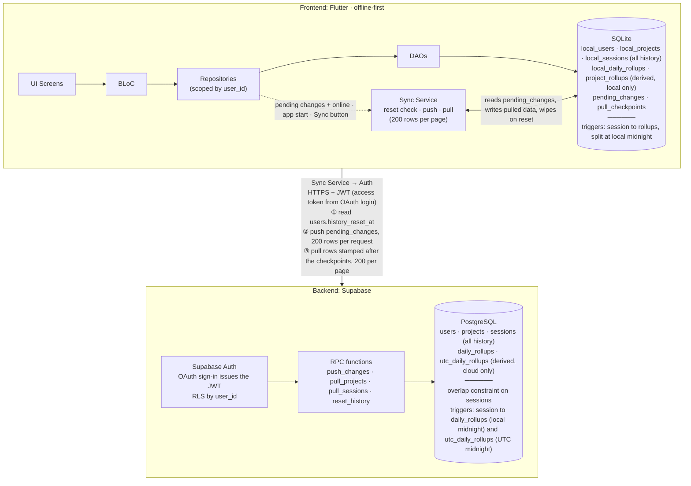
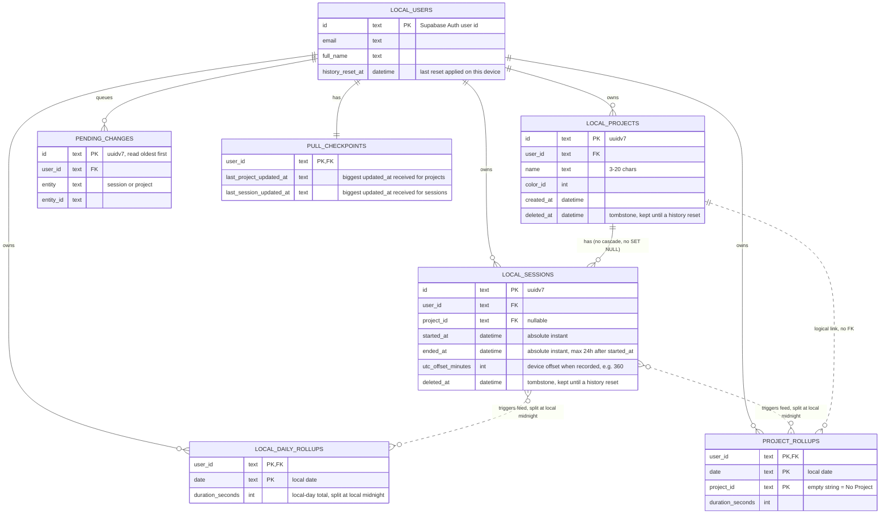
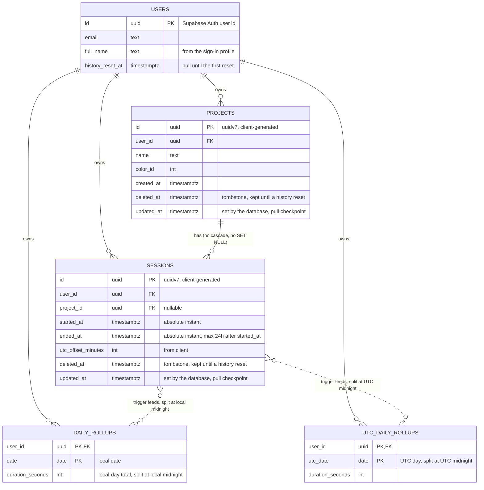

# Tarkeez: data and sync architecture

Tarkeez is offline-first. The app reads and writes a local SQLite database, and a sync layer copies changes to Supabase (PostgreSQL) in the background.

**Sessions are the source of truth.** Every session is kept, locally and in the cloud, until the user deletes all history. All totals (daily, per project, leaderboard, streak) are derived from sessions. Only three things sync: `users` (full name and history reset value), `projects` and `sessions`.

**Delete all history removes everything the user has**: projects, sessions and all rollups, in the cloud and on every device. Only the account (the `users` row) stays.

## Contents

1. [Key conventions](#key-conventions)
2. [How a session is split at midnight](#how-a-session-is-split-at-midnight)
3. [How sync works](#how-sync-works)
4. [Architecture diagram](#architecture-diagram)
5. [Local ER diagram (SQLite)](#local-er-diagram-sqlite)
6. [Server ER diagram (PostgreSQL)](#server-er-diagram-postgresql)
7. [Overlap rule](#overlap-rule)
8. [Editing and deleting](#editing-and-deleting)
9. [Rebuilding rollups](#rebuilding-rollups)
10. [Design notes](#design-notes)

## Key conventions

- **Naming:** a table that exists on both sides uses its plain name in the cloud and a `local_` prefix in SQLite (`users` and `local_users`). A table that exists on one side keeps its plain name.
- **IDs:** primary keys are client-generated UUIDv7 (`const Uuid().v7()`). Exceptions:
  - `users.id` is the Supabase Auth user id, the same value locally and in the cloud.
  - Rollup tables use composite keys (for example `user_id + date`).
  - `pull_checkpoints` is keyed by `user_id`.
- **Accounts:** every table except `users` has `user_id`, and every query is scoped to the active account. Cloud RLS is `user_id = auth.uid()`.
- **What syncs:**

  | Local table           | Cloud table         | Syncs?                                                 |
  | --------------------- | ------------------- | ------------------------------------------------------ |
  | `local_users`         | `users`             | Yes, cloud to device (`full_name`, `history_reset_at`) |
  | `local_projects`      | `projects`          | Yes, both ways                                         |
  | `local_sessions`      | `sessions`          | Yes, both ways                                         |
  | `local_daily_rollups` | `daily_rollups`     | No. Each side derives its own from sessions            |
  | `project_rollups`     | none                | Local only, derived from sessions                      |
  | none                  | `utc_daily_rollups` | Cloud only, derived from sessions                      |
  | `pending_changes`     | none                | Local bookkeeping                                      |
  | `pull_checkpoints`    | none                | Local bookkeeping. Each device has its own position    |

- **Time:** `started_at` and `ended_at` are absolute instants. `utc_offset_minutes` is the device's offset when the session was recorded. Local time is `started_at + utc_offset_minutes`. Sessions store no date column. Calendar dates exist only in the rollup tables, and UTC dates only in `utc_daily_rollups`.
- **Daily totals:**
  - `daily_rollups`: local-day totals. Stored locally (heatmaps, reports, streaks) and in the cloud (streak leaderboard).
  - `utc_daily_rollups`: UTC-day totals for the time leaderboard. Cloud only.
  - `project_rollups`: local-day totals per project for project charts. Local only.
- **Session length cap:** at most 24 hours, so a session touches at most two local days and two UTC days, and each trigger writes at most two slices per table.
- **Immutable sessions:** a saved session only changes by getting `deleted_at`, and that is one-way. Triggers react only to an insert and to `deleted_at` being set. Projects can be edited.
- **No overlapping sessions:** a user never has two live sessions that overlap in time, even across devices. The cloud keeps the longest and drops the other (see "Overlap rule").
- **Tombstones:** a normal delete never removes a row. Projects and sessions get `deleted_at`, which syncs like any other change. Only "Delete all history" hard-deletes rows (see "Delete all history").
- **History reset:** `users.history_reset_at` is null until the first "Delete all history". A reset hard-deletes the user's projects, sessions and rollups in the cloud and stamps this value. Every device wipes its own copy when it sees a newer value than its own.
- **Foreign keys:** a project row is never removed except by a history reset, so `project_id` on a session always resolves. There is no cascade or `SET NULL`. A reset deletes sessions before projects, locally and in the cloud. A session whose project is deleted counts as "No Project" when read.
- **Page size:** a push or a pull moves at most 200 rows per request, and the app reads, writes and binds at most 200 rows at a time. A device that was offline for years syncs in many small pages (see "Pages of 200 rows").
- **Pull checkpoint:** the database stamps every project and session with `updated_at` whenever it is added or changed. Each device stores the biggest stamp it has received, one for projects and one for sessions, in `pull_checkpoints`. A pull asks for rows stamped after the checkpoint, starting 2 minutes before it (safety rule 5).
- **Sync trigger:** there is no timer. Sync runs when `pending_changes` has rows and the device is online, at app start, and when the user taps the Sync button (see "When sync runs").
- **Storage:** about 0.5 KB per session including indexes. At 500 sessions a month that is about 250 KB per user per month, or 3 MB per user per year. Rollups add a few KB per user per year.

## How a session is split at midnight

### Stored values

```
started_at           absolute instant
ended_at             absolute instant, at most 24 h after started_at
utc_offset_minutes   the device's offset from UTC when recorded, e.g. +360
```

### Instants and wall-clock time

- An **instant** is one exact moment, like "21:00 UTC on Oct 23". Every timezone agrees on it.
- A **wall-clock time** is what a local clock showed, like "22:00". Without a timezone it is not a single moment.

The app stores the instant and the offset, and calculates local time when needed:

```
local time = started_at + utc_offset_minutes
```

Instants are used because overlap checks, durations and ordering need one common timeline. A phone in Dhaka (UTC+6) that recorded 22:00 to 23:00 and a device at UTC+0 that recorded 16:30 to 17:30 look unrelated as wall-clock numbers, but they overlap by 30 minutes in real time. Wall-clock times are also ambiguous when daylight saving repeats an hour.

### One function, two calls

```
split(start, end, offset):
  shift both ends by the offset
  cut at every 24-hour boundary on the shifted timeline
  return one slice per day touched      (at most two)

local rollups : split(started_at, ended_at, utc_offset_minutes)
UTC rollups   : split(started_at, ended_at, 0)
```

The two splits are independent, and each adds up to the full session length.

### Example: a session that crosses both midnights

A 4-hour session on a device at UTC+1 (`utc_offset_minutes = 60`), started at 22:00 local on Oct 23. Local midnight is 2 hours in, and UTC midnight is 3 hours in. Stored values:

```
started_at           = Oct 23, 21:00 UTC
ended_at             = Oct 24, 01:00 UTC
utc_offset_minutes   = 60
```

| Moment                     | UTC           | Local (UTC+1) |
| -------------------------- | ------------- | ------------- |
| Start                      | Oct 23, 21:00 | Oct 23, 22:00 |
| 2 h in: **local midnight** | Oct 23, 23:00 | Oct 24, 00:00 |
| 3 h in: **UTC midnight**   | Oct 24, 00:00 | Oct 24, 01:00 |
| End                        | Oct 24, 01:00 | Oct 24, 02:00 |

```
time (UTC)  21:00     22:00     23:00     00:00     01:00
              ├─────────┼─────────┼─────────┼─────────┤
local time  22:00     23:00     00:00     01:00     02:00

UTC days      │        Oct 23 · 3 h         │Oct 24·1h│
local days    │   Oct 23 · 2 h    │   Oct 24 · 2 h    │
```

| Rollup table                                         | Cut at         | Oct 23   | Oct 24  | Total    |
| ---------------------------------------------------- | -------------- | -------- | ------- | -------- |
| `local_daily_rollups` (`daily_rollups` in the cloud) | local midnight | 7,200 s  | 7,200 s | 14,400 s |
| `project_rollups`                                    | local midnight | 7,200 s  | 7,200 s | 14,400 s |
| `utc_daily_rollups`                                  | UTC midnight   | 10,800 s | 3,600 s | 14,400 s |

The local split shifts the session by the offset (21:00 to 01:00 becomes 22:00 to 02:00) and cuts at 00:00. The UTC split cuts the stored instants at 00:00 UTC.

### Edge cases

- **Both midnights in one session:** a session contains both only if it is longer than the gap between them, which equals the offset's distance from UTC: 1 hour for UTC+1, 6 hours for Dhaka (UTC+6).
- **Deleting a session** recomputes the same slices and subtracts them. A tombstone that arrives already deleted adds nothing.
- **Daylight saving:** one offset is stored per session. If the clocks change mid-session, the split uses the start offset, so that session's day boundary can be off by up to one hour.
- **Ending exactly at midnight** produces no empty slice for the next day.

## How sync works

A sync run **checks for a reset, then pushes, then pulls**.

- **Reset check:** read the device's own `users` row. If `history_reset_at` is newer than the local value, wipe all local projects, sessions, rollups, pending changes and checkpoints (see "Delete all history"). Nothing from before the reset is pushed.
- **Push:** send the rows listed in `pending_changes`, 200 at a time, projects first, then sessions, until the queue is empty.
- **Pull:** fetch every project and session stamped after the device's checkpoints, 200 at a time, projects first, until a page comes back with fewer than 200 rows.

### When sync runs

There is no timer. Sync starts only on one of these three events, and only while the device is online:

| Event                          | Run                                                          |
| ------------------------------ | ------------------------------------------------------------ |
| `pending_changes` is not empty | reset check, push, then pull                                 |
| App start                      | reset check, push (if `pending_changes` has rows), then pull |
| Sync button                    | reset check, push (if `pending_changes` has rows), then pull |

`pending_changes` is not empty covers two cases: a change is added while the device is online (session finished, project edit, delete), and the connection returns while changes are waiting.

- **App start while offline:** the sync runs when the connection returns.
- **Offline:** changes wait in `pending_changes` and no attempt is made. A sync starts when the connection returns.
- **Failed push:** the rows stay in `pending_changes` and are retried at the next event above. Nothing retries on a timer.
- **No pending changes:** the device does not poll. It receives other devices' changes (and resets) at app start, on the Sync button, or in the sync that follows its own next change.
- **Overlapping events:** events that arrive while a run is in progress are merged into one follow-up run.

### Pages of 200 rows

Supabase returns at most 1,000 rows per request, and SQLite binds at most about 32,000 values in one statement. Sync stays far below both: a request carries at most 200 rows, and every local read or write handles at most 200 rows.

**Push.** The queue is read in pages, oldest first:

1. Read the next 200 entries of `pending_changes` after the cursor (the id of the last entry read).
2. Group them by row id, because several edits of one project leave several entries, and read those rows (at most 200).
3. Send them in one `push_changes` request.
4. Remove the entries the cloud answered, whether applied, rejected or dropped.
5. Move the cursor and repeat until a page is empty.

- An entry the cloud did not answer (a temporary error) stays in the queue. The cursor moves past it, so the loop always ends, and the next sync retries it.
- An entry added during the run has a bigger id, so the same run picks it up.
- If a request fails (the connection drops, for example), every later entry stays untouched. Pages already answered are gone from the queue, so the next sync continues where this one stopped.
- `push_changes` rejects a request with more than 200 rows in a list.

**Pull.** Pages are read by `(updated_at, id)`:

1. The first page starts 2 minutes before the checkpoint (safety rule 5). With no checkpoint it starts at the beginning.
2. Each next page starts after the last row of the previous one, by `updated_at` and then `id`, so rows with the same timestamp are never split or skipped.
3. The app saves each page in one transaction, moves the checkpoint, and asks for the next page.
4. A page with fewer than 200 rows is the last one.

`pull_projects` and `pull_sessions` never return more than 200 rows.

Example: a phone was offline for 5 years and holds 30,000 queued sessions. When the connection returns it sends 150 requests of 200 sessions. A new tablet pulls the same 30,000 sessions in 150 pages. Either sync can be interrupted and continues from the last finished page.

### Pieces

| Piece              | Where                               | Purpose                                                                                                      |
| ------------------ | ----------------------------------- | ------------------------------------------------------------------------------------------------------------ |
| `pending_changes`  | device                              | Rows changed locally and not yet pushed. Stores the table and id only. The row is read at push time.         |
| `updated_at`       | cloud `projects` and `sessions`     | Time the database last changed the row. A trigger sets it, so device clocks never matter.                    |
| `pull_checkpoints` | device                              | Biggest `updated_at` received: `last_project_updated_at` and `last_session_updated_at`. One row per account. |
| `history_reset_at` | cloud `users`, device `local_users` | Time of the last "Delete all history". A device that sees a newer cloud value wipes its data.                |

Pull query (200 rows per page, the same for sessions):

```sql
select * from projects
where user_id = :me and (updated_at, id) > (:after_stamp, :after_id)
order by updated_at, id limit 200;
-- first page of a pull: :after_stamp = checkpoint - 2 minutes
-- next pages: the updated_at and id of the last row received
-- after each page, move the checkpoint to the biggest updated_at received
```

Cloud sessions in `updated_at` order, with the phone's checkpoint:

```
 10:00 ■■■■■■■■■■  50 sessions  │  10:20 ■■■■■■  30 sessions
                                ▲
                 phone's checkpoint = 10:00
     next pull = everything right of 09:58 (checkpoint - 2 min)
```

When nothing changed, a pull still returns the newest row and every row stamped within 2 minutes before it. The device already has them, so saving them changes nothing. The `(user_id, updated_at)` indexes keep the request cheap.

### Example: phone, tablet and cloud

| Time  | Device | What happens                                                                                                                                          | Rows downloaded | Checkpoint after |
| ----- | ------ | ----------------------------------------------------------------------------------------------------------------------------------------------------- | --------------- | ---------------- |
| 10:00 | Phone  | Connection returns with 50 pending sessions. Pushes them, stamped 10:00. Pulls with no checkpoint: gets its own 50 back.                              | 50 (own)        | 10:00            |
| 10:10 | Tablet | App start on a new device, nothing to push. Pulls with no checkpoint: every row.                                                                      | **50**          | 10:00            |
| 10:20 | Tablet | The 30 sessions recorded since are pending, so it pushes them, stamped 10:20. Pulls from 09:58 (checkpoint 10:00 minus 2 minutes): the 50 it has and its own 30. | 80 (30 own)     | 10:20            |
| 10:30 | Phone  | App start, nothing pending. Pulls from 09:58: its own 50 and the tablet's 30.                                                                         | 80 (**30 new**) | 10:20            |
| 10:40 | Tablet | Sync button, nothing pending. Pulls from 10:18: the 30 stamped 10:20, which it already has.                                                           | 30 (none new)   | 10:20            |

Both devices end with the same 80 sessions. The phone downloaded 80 rows, and 30 of them were new to it.

### Edits, deletes and overlap drops

Every other change uses the same path. The cloud re-stamps the row, so it falls after every device's checkpoint and is pulled.

| Change                                 | Cloud                                     | Other devices                                                                   |
| -------------------------------------- | ----------------------------------------- | ------------------------------------------------------------------------------- |
| Phone renames a project at 11:00       | Replaces the row, stamps 11:00            | The tablet's next pull returns the project and saves the new name               |
| Tablet deletes a session at 11:05      | Sets `deleted_at`, stamps 11:05           | The phone's next pull returns the tombstone, and its trigger subtracts the time |
| Overlap makes the cloud drop a session | Sets `deleted_at` on the loser, stamps it | Every device, including the one that recorded it, pulls the tombstone           |

### Rows that arrive twice

A device can receive rows it already has: its own rows right after a push, and rows repeated by the overlap (rule 5 below). This is safe:

- Rows are saved with an **upsert by id**, so there are no duplicates.
- A session never changes after it is saved, so the repeat is identical.
- Triggers react only to a new row or to the first `deleted_at`, so nothing is counted twice.

### Safety rules

1. **A pull never overwrites a row that still has an entry in `pending_changes`.** That row has an unpushed edit. The next push settles it (last push wins).
2. **A tombstone is one-way.** When saving a pulled row, an existing `deleted_at` is kept, so a stale copy never revives a deleted row.
3. **Work in pages and save progress after each page.** A pull saves the checkpoint after each page, and a push removes the answered entries after each page, so a failure repeats at most one page.
4. **A checkpoint only moves forward.**
5. **Overlap for late commits:** a pull asks for `updated_at > checkpoint - 2 minutes`. A row's `updated_at` is the time its transaction started, but other devices see the row only when it commits, so a slow push can commit after a faster one that started later. Example: the phone starts pushing 200 sessions at 10:00:00 and commits at 10:00:03. The tablet starts at 10:00:01 and commits at 10:00:01.2. A laptop that pulls at 10:00:02 sees only the tablet's row and moves its checkpoint to 10:00:01. Without the overlap, the phone's rows (stamped 10:00:00) would never reach the laptop. Supabase stops a request that runs longer than the statement timeout (8 seconds by default for signed-in users), so a late commit always falls inside the 2 minutes.
6. **Reset check before push.** A device that missed a reset wipes itself before it sends anything, so rows from before the reset never reach the cloud.

### Special situations

| Situation                                    | Behaviour                                                                                                                                                                                                                                                                               |
| -------------------------------------------- | --------------------------------------------------------------------------------------------------------------------------------------------------------------------------------------------------------------------------------------------------------------------------------------- |
| Changes made while offline                   | Rows wait in `pending_changes`, and no attempt is made. A sync starts when the connection returns.                                                                                                                                                                                      |
| Offline for years                            | The queue holds thousands of entries. It is pushed 200 rows per request, oldest first, and each page leaves the queue when the cloud answers, so an interrupted sync continues where it stopped.                                                                                         |
| New phone, reinstall, or cleared app storage | No checkpoint, so the first pull returns everything, 200 rows per request. This restores the history once (about 3 MB per year of history).                                                                                                                                             |
| Second account on the same device            | Rows and checkpoints are per `user_id`, so accounts never mix.                                                                                                                                                                                                                          |
| Offline for a week                           | The checkpoint is a week old, so the next pull returns the week's changes, in pages.                                                                                                                                                                                                    |
| Two devices edit the same project offline    | Last push wins for the whole row. The other device pulls the winning version on its next sync.                                                                                                                                                                                          |
| "Delete all history" on another device       | The device's next sync reads a newer `history_reset_at` on its `users` row, before it pushes. It wipes its projects, sessions and rollups, clears its pending changes and checkpoints, and pulls from scratch.                                                                          |
| Device offline during a reset                | Same as above. Everything the device recorded since the reset is wiped too, including rows still in `pending_changes`. If a stale push still reaches the cloud (a reset lands in the middle of a sync), `push_changes` rejects projects created before the reset and sessions that ended before it. |

### Cost

A device downloads its own rows once after pushing them, and re-reads the rows stamped within 2 minutes before its checkpoint on every pull. That is about one extra copy of the user's data, roughly 3 MB per user per year, plus a few rows per sync.

## Architecture diagram

**Workflow**

1. **Write:** when a session is finished, UI → BLoC → Repository → Drift DAO writes it to `local_sessions` with its `utc_offset_minutes`. Local triggers split it at local midnight and update `local_daily_rollups` and `project_rollups`. The DAO adds a row to `pending_changes`.
2. **Read:** session lists read `local_sessions`. Reports, heatmaps and streaks read the rollups. All reads are local.
3. **Sync starts** when `pending_changes` has rows and the device is online, at app start, or on the Sync button. If the device is offline, nothing is attempted. A sync begins with the reset check: the app reads its `users` row. If `history_reset_at` is newer than the local value, it wipes local projects, sessions, rollups and pending changes, and clears its checkpoints.
4. **Push:** the Sync Service reads `pending_changes` 200 entries at a time and sends each page to `push_changes`, projects first, then sessions, until the queue is empty. The cloud upserts the rows by UUID (safe to retry). It rejects projects created before the last reset and sessions that ended before it, and it resolves overlaps (see "Overlap rule"). Cloud triggers update `daily_rollups` and `utc_daily_rollups`. The response lists which rows were applied, rejected and dropped, and the device applies that locally and removes the answered entries from the queue.
5. **Pull (right after every push):** the app calls `pull_projects`, then `pull_sessions`, 200 rows per page, starting 2 minutes before `last_project_updated_at` and `last_session_updated_at`, until a page has fewer than 200 rows. The app upserts each page and moves the checkpoint. Local triggers rebuild the rollups. No rollup is downloaded.

**In plain words**

A finished session is written to SQLite. Triggers add its seconds to the local rollups immediately, so reports update without scanning sessions, and a row is added to `pending_changes`. None of this needs internet.

When `pending_changes` has rows and the device is online, the Sync Service first reads the user's `users` row from Supabase over HTTPS with the user's JWT. If a history reset is newer than the one the device has applied, the device wipes its data. Then it sends the pending projects and sessions, 200 per request. If the device is offline, the rows wait and nothing is attempted until the connection returns. A sync also runs at app start and when the user taps the Sync button. There is no timer. The cloud keeps the longest session when two overlap, and its triggers add each kept session to `daily_rollups` and `utc_daily_rollups`. The app then downloads the rows stamped after its checkpoints, 200 per page. Pulled sessions go through the same local triggers as recorded ones.



## Local ER diagram (SQLite)

- `local_users` holds every account that has signed in on this device, created from the cloud `users` row at sign-in. `history_reset_at` is the last reset this device applied.
- Triggers on `local_sessions` split each session at local midnight into `local_daily_rollups` and `project_rollups`. They fire on insert and when `deleted_at` is first set. An insert that already has `deleted_at` (a pulled tombstone) adds nothing. Pulled rows are saved with upserts, never replace.
- `project_rollups` has no FK to projects. A project that is missing or has `deleted_at` set is counted as "No Project" (`''`) through the `project_rollups_effective` view.
- `pending_changes` lists the rows to push. It stores no copy of the data. Every change is an upsert, and a delete is `deleted_at` being set. Push reads it 200 entries at a time, oldest first, and removes the entries the cloud answered. A non-empty table is what starts a sync when the device is online.
- `pull_checkpoints` stores, per account, the biggest `updated_at` received for projects and for sessions. A pull asks for rows stamped after them, starting 2 minutes before.
- A history reset wipes the account's `local_sessions`, `local_projects`, `local_daily_rollups`, `project_rollups` and `pending_changes`, in that order for the first two (sessions point at projects), and clears both checkpoints. Triggers do not run for this wipe.



## Server ER diagram (PostgreSQL)

- `users` is keyed by the Supabase Auth user id. `full_name` is filled from the sign-in profile when the account is created and is copied to the device on every sync. `history_reset_at` is null until the first "delete all history". Devices read it at the start of every sync.
- `push_changes` takes at most 200 rows per list. It upserts projects first, then sessions. Each row runs in its own savepoint, so one failure does not fail the batch. A project upsert replaces the whole row (last push wins). Projects created before `history_reset_at` and sessions that ended before it are rejected. Overlaps follow the "Overlap rule".
- `pull_projects` and `pull_sessions` return one page of at most 200 rows, read by `(updated_at, id)` after the cursor the device sends.
- `reset_history` hard-deletes the user's `utc_daily_rollups`, `daily_rollups`, `sessions` and `projects` (in that order) and sets `history_reset_at = now()`, all in one transaction. Triggers do not run for these deletes. The `users` row stays.
- A trigger sets `updated_at = now()` on every insert or update of a project or session. Device checkpoints track it (see "How sync works").
- Each live session feeds two rollup tables, one slice per day touched (see "How a session is split at midnight"):
  - `daily_rollups`: split at local midnight using `utc_offset_minutes`. Powers the streak leaderboard.
  - `utc_daily_rollups`: split at UTC midnight. Powers the time leaderboard.
- Triggers add when a live session is inserted and subtract when `deleted_at` is first set. A retried push cannot count twice.
- Indexes: `sessions (user_id, updated_at)` and `projects (user_id, updated_at)`.
- There is no `project_rollups` in the cloud. Project charts use the local copy.
- The cloud keeps no per-device state. Each device keeps its own position in `pull_checkpoints`.

```sql
create extension if not exists btree_gist with schema extensions;

-- Backstop only. push_changes resolves overlaps first (the longest session wins).
alter table sessions add constraint no_overlap
  exclude using gist (
    user_id with =,
    tstzrange(started_at, ended_at) with &&
  ) where (deleted_at is null);
```



## Overlap rule

A user never has two live sessions that overlap in time, even if two devices ran at once while offline. Only finished sessions are pushed, so a running timer never conflicts. Until a device syncs it cannot know about an overlap, so its totals may briefly count both sessions.

`push_changes` handles each pushed session in four steps:

1. Find the user's live sessions that overlap it.
2. If there are none, insert it.
3. If it is **longer than every session it overlaps**, set `deleted_at` on those sessions and insert it. A tie goes to the earlier `started_at`, then to the lower id.
4. Otherwise it loses and is stored with `deleted_at` already set. The tombstone makes a retry a no-op and keeps every device consistent.

Nothing is trimmed: the loser's time leaves the totals. The change reaches every device like this:

- Cloud triggers subtract the dropped sessions from `daily_rollups` and `utc_daily_rollups`.
- A pushed session that lost is reported in the `push_changes` response, and the pushing device sets `deleted_at` on its local copy immediately.
- Every dropped session gets a fresh `updated_at`, so every device, including the one that recorded it, pulls the tombstone on its next sync and subtracts the time.

The exclusion constraint on `sessions` is a backstop. A bug in `push_changes` cannot leave overlapping live sessions in the database.

## Editing and deleting

**Edit a project**

1. The device updates the local row (name or colour) and adds it to `pending_changes`.
2. The next push replaces the whole cloud row and stamps a new `updated_at`. If two devices edited the same project offline, the last push wins.
3. Every other device pulls the new version on its next sync. The device that lost gets the winning version the same way.
4. Sessions and rollups are unchanged.

**Delete a project**

1. The device sets `deleted_at` on the project and adds it to `pending_changes`.
2. Sessions, rollups and `project_id` values are unchanged.
3. Project lists filter on `deleted_at is null`.
4. Queries that group by project use the `project_rollups_effective` view (and the same rule on sessions). The effective project is `project_id` if that project exists and has no `deleted_at`, otherwise `''` (No Project).
5. Undoing the delete is clearing `deleted_at`.

**Delete a session**

1. The device sets `deleted_at` on the session and adds it to `pending_changes`.
2. The local trigger subtracts its seconds from `local_daily_rollups` and `project_rollups`.
3. Cloud triggers subtract them from `daily_rollups` and `utc_daily_rollups`.
4. Other devices pull the tombstone on their next sync, and their triggers subtract the same seconds. No rollup values are sent.

**Delete all history**

This removes every project, session and rollup the user has. Only the account stays.

1. The app calls `reset_history` (online only). In one transaction the cloud hard-deletes the user's `utc_daily_rollups`, `daily_rollups`, `sessions` and `projects`, in that order because sessions point at projects, and sets `users.history_reset_at = now()`. No trigger runs for these deletes.
2. The calling device wipes its local sessions, projects, `local_daily_rollups` and `project_rollups`, clears its `pending_changes` and both checkpoints, and stores the new `history_reset_at`.
3. Every other device sees the newer `history_reset_at` in the reset check at the start of its next sync, before it pushes anything, and does the same. Anything it recorded offline since the reset is wiped too.
4. As a backstop, `push_changes` rejects any project with `created_at < history_reset_at` and any session with `ended_at < history_reset_at`. The device drops rejected rows locally without requeuing them.
5. If the app gets no answer from `reset_history` (for example the connection drops), it shows an error and leaves local data alone. The cloud may already be reset. The app starts a sync as soon as it can, and the reset check clears the device if the reset went through. Running the reset again is safe.

Example:

| Time  | Device                                             | What happens                                                                                                                                                                                          |
| ----- | -------------------------------------------------- | ----------------------------------------------------------------------------------------------------------------------------------------------------------------------------------------------------- |
| 12:00 | Phone                                              | The user taps "Delete all history". The cloud deletes the rollups, sessions and projects and sets `history_reset_at` to 12:00. The phone wipes its local data.                                        |
| 12:30 | Tablet (offline since 11:00, 20 unsynced sessions) | The connection returns. The reset check sees 12:00, which is newer than the tablet's value. It wipes its projects, sessions, rollups, the 20 pending entries and its checkpoints. It pushes nothing. |
| 12:30 | Tablet                                             | The pull starts with no checkpoints and returns 0 rows, because the cloud is empty.                                                                                                                   |

## Rebuilding rollups

Rollups can always be recomputed from sessions. `rebuild_rollups(user_id)` deletes the account's rows in `local_daily_rollups` and `project_rollups` and recreates them from all sessions where `deleted_at is null`, using the same split function. Use it for repairs, after a schema migration, or after a very large first pull. The device also runs it after it removes rejected sessions, because a hard delete fires no trigger. The cloud has the same function for `daily_rollups` and `utc_daily_rollups` (the latter split at UTC midnight).

## Design notes

- **`updated_at` (cloud `projects` and `sessions`):** set by the database and used for pull checkpoints. A device-written time would not work: a session recorded offline on Monday and pushed on Wednesday would carry a Monday time, and a device whose checkpoint is already at Tuesday would miss it.
- **`history_reset_at` (`users`, `local_users`):** one timestamp, null until the first reset. A device wipes its projects, sessions and rollups when the cloud value is newer than its own. The cloud also uses it to reject stale pushes.
- **Reset check before push:** a phone that was offline during a reset still holds old projects and sessions. Checking first means it wipes them before it tries to push anything, so the cloud never has to reject them and the phone never keeps sessions that point at projects the cloud refused.
- **`utc_offset_minutes`:** an instant alone does not give the user's local date. The offset recorded with the session lets SQLite and Postgres find the same local midnight, even if the phone's timezone changes later.