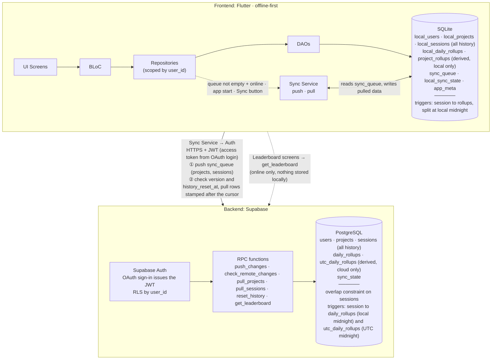
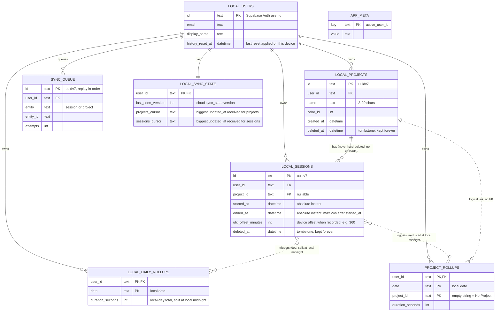
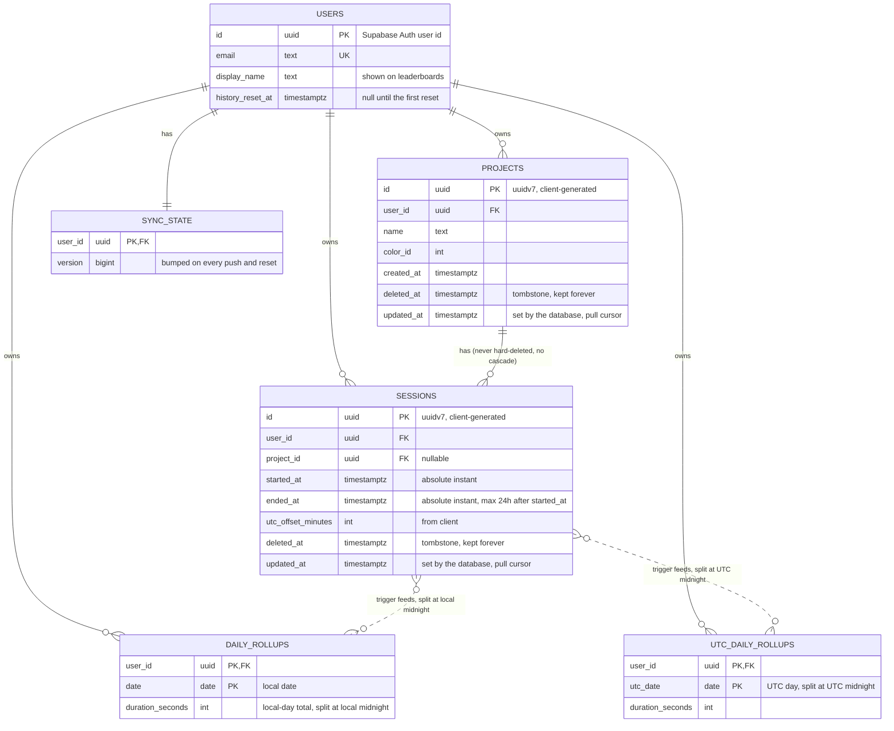

# Tarkeez: data and sync architecture

Tarkeez is offline-first. The app reads and writes a local SQLite database, and a sync layer copies changes to Supabase (PostgreSQL) in the background.

**Sessions are the source of truth.** Every session is kept forever, locally and in the cloud. All totals (daily, per project, leaderboard, streak) are derived from sessions. Only three things sync: `users` (display name and history reset value), `projects` and `sessions`.

## Contents

1. [Key conventions](#key-conventions)
2. [How a session is split at midnight](#how-a-session-is-split-at-midnight)
3. [How sync works](#how-sync-works)
4. [Architecture diagram](#architecture-diagram)
5. [Local ER diagram (SQLite)](#local-er-diagram-sqlite)
6. [Server ER diagram (PostgreSQL)](#server-er-diagram-postgresql)
7. [Overlap rule](#overlap-rule)
8. [Editing and deleting](#editing-and-deleting)
9. [Rebuilding rollups](#rebuilding-rollups)
10. [Design notes](#design-notes)

## Key conventions

- **Naming:** a table that exists on both sides uses its plain name in the cloud and a `local_` prefix in SQLite (`users` and `local_users`). A table that exists on one side keeps its plain name.
- **IDs:** primary keys are client-generated UUIDv7 (`const Uuid().v7()`). Exceptions:
  - `users.id` is the Supabase Auth user id, the same value locally and in the cloud.
  - Rollup tables use composite keys (for example `user_id + date`).
  - `app_meta` is a key-value table, and the sync-state tables are keyed by `user_id`.
- **Accounts:** every table except `users` has `user_id`, and every query is scoped to the active account. Cloud RLS is `user_id = auth.uid()`.
- **What syncs:**

  | Local table              | Cloud table         | Syncs?                                                    |
  | ------------------------ | ------------------- | --------------------------------------------------------- |
  | `local_users`            | `users`             | Yes, cloud to device (`display_name`, `history_reset_at`) |
  | `local_projects`         | `projects`          | Yes, both ways                                            |
  | `local_sessions`         | `sessions`          | Yes, both ways                                            |
  | `local_daily_rollups`    | `daily_rollups`     | No. Each side derives its own from sessions               |
  | `project_rollups`        | none                | Local only, derived from sessions                         |
  | none                     | `utc_daily_rollups` | Cloud only, derived from sessions                         |
  | `sync_queue`, `app_meta` | none                | Local bookkeeping                                         |
  | `local_sync_state`       | `sync_state`        | No. Separate bookkeeping on each side                     |

- **Time:** `started_at` and `ended_at` are absolute instants. `utc_offset_minutes` is the device's offset when the session was recorded. Local time is `started_at + utc_offset_minutes`. Sessions store no date column. Calendar dates exist only in the rollup tables, and UTC dates only in `utc_daily_rollups`.
- **Daily totals:**
  - `daily_rollups`: local-day totals. Stored locally (heatmaps, reports, streaks) and in the cloud (streak leaderboard).
  - `utc_daily_rollups`: UTC-day totals for the time leaderboard. Cloud only.
  - `project_rollups`: local-day totals per project for project charts. Local only.
- **Session length cap:** at most 24 hours, so a session touches at most two local days and two UTC days, and each trigger writes at most two slices per table.
- **Immutable sessions:** a saved session only changes by getting `deleted_at`, and that is one-way. Triggers react only to an insert and to `deleted_at` being set. Projects can be edited.
- **No overlapping sessions:** a user never has two live sessions that overlap in time, even across devices. The cloud keeps the longest and drops the other (see "Overlap rule").
- **Tombstones, kept forever:** projects and sessions are never hard-deleted. They get `deleted_at`, which syncs like any other change.
- **Foreign keys:** project rows are never removed, so `project_id` on a session always resolves. There is no cascade or `SET NULL`. A session whose project is deleted counts as "No Project" when read.
- **Sync cursor:** the database stamps every project and session with `updated_at` whenever it is added or changed. Each device stores the biggest stamp it has received (its cursor) and pulls rows stamped after it.
- **Sync trigger:** there is no timer. Sync runs when `sync_queue` has rows and the device is online, at app start, and when the user taps the Sync button (see "When sync runs").
- **Storage:** about 0.5 KB per session including indexes. At 500 sessions a month that is about 250 KB per user per month, or 3 MB per user per year. Rollups add a few KB per user per year.

## How a session is split at midnight

### Stored values

```
started_at           absolute instant
ended_at             absolute instant, at most 24 h after started_at
utc_offset_minutes   the device's offset from UTC when recorded, e.g. +360
```

### Instants and wall-clock time

- An **instant** is one exact moment, like "21:00 UTC on Oct 23". Every timezone agrees on it.
- A **wall-clock time** is what a local clock showed, like "22:00". Without a timezone it is not a single moment.

The app stores the instant and the offset, and calculates local time when needed:

```
local time = started_at + utc_offset_minutes
```

Instants are used because overlap checks, durations and ordering need one common timeline. A phone in Dhaka (UTC+6) that recorded 22:00 to 23:00 and a device at UTC+0 that recorded 16:30 to 17:30 look unrelated as wall-clock numbers, but they overlap by 30 minutes in real time. Wall-clock times are also ambiguous when daylight saving repeats an hour.

### One function, two calls

```
split(start, end, offset):
  shift both ends by the offset
  cut at every 24-hour boundary on the shifted timeline
  return one slice per day touched      (at most two)

local rollups : split(started_at, ended_at, utc_offset_minutes)
UTC rollups   : split(started_at, ended_at, 0)
```

The two splits are independent, and each adds up to the full session length.

### Example: a session that crosses both midnights

A 4-hour session on a device at UTC+1 (`utc_offset_minutes = 60`), started at 22:00 local on Oct 23. Local midnight is 2 hours in, and UTC midnight is 3 hours in. Stored values:

```
started_at           = Oct 23, 21:00 UTC
ended_at             = Oct 24, 01:00 UTC
utc_offset_minutes   = 60
```

| Moment                     | UTC           | Local (UTC+1) |
| -------------------------- | ------------- | ------------- |
| Start                      | Oct 23, 21:00 | Oct 23, 22:00 |
| 2 h in: **local midnight** | Oct 23, 23:00 | Oct 24, 00:00 |
| 3 h in: **UTC midnight**   | Oct 24, 00:00 | Oct 24, 01:00 |
| End                        | Oct 24, 01:00 | Oct 24, 02:00 |

```
time (UTC)  21:00     22:00     23:00     00:00     01:00
              ├─────────┼─────────┼─────────┼─────────┤
local time  22:00     23:00     00:00     01:00     02:00

UTC days      │        Oct 23 · 3 h         │Oct 24·1h│
local days    │   Oct 23 · 2 h    │   Oct 24 · 2 h    │
```

| Rollup table                                         | Cut at         | Oct 23   | Oct 24  | Total    |
| ---------------------------------------------------- | -------------- | -------- | ------- | -------- |
| `local_daily_rollups` (`daily_rollups` in the cloud) | local midnight | 7,200 s  | 7,200 s | 14,400 s |
| `project_rollups`                                    | local midnight | 7,200 s  | 7,200 s | 14,400 s |
| `utc_daily_rollups`                                  | UTC midnight   | 10,800 s | 3,600 s | 14,400 s |

The local split shifts the session by the offset (21:00 to 01:00 becomes 22:00 to 02:00) and cuts at 00:00. The UTC split cuts the stored instants at 00:00 UTC.

### Edge cases

- **Both midnights in one session:** a session contains both only if it is longer than the gap between them, which equals the offset's distance from UTC: 1 hour for UTC+1, 6 hours for Dhaka (UTC+6).
- **Deleting a session** recomputes the same slices and subtracts them. A tombstone that arrives already deleted adds nothing.
- **Daylight saving:** one offset is stored per session. If the clocks change mid-session, the split uses the start offset, so that session's day boundary can be off by up to one hour.
- **Ending exactly at midnight** produces no empty slice for the next day.

## How sync works

A sync run **pushes first, then pulls**.

- **Push:** send the rows listed in `sync_queue`.
- **Pull:** fetch every row stamped after the device's cursor.

### When sync runs

There is no timer. Sync starts only on one of these three events, and only while the device is online:

| Event                     | Run                                     |
| ------------------------- | --------------------------------------- |
| `sync_queue` is not empty | push, then pull                         |
| App start                 | push (if the queue has rows), then pull |
| Sync button               | push (if the queue has rows), then pull |

`sync_queue` is not empty covers two cases: a change is queued while the device is online (session finished, project edit, delete), and the connection returns while rows are waiting.

- **App start while offline:** the sync runs when the connection returns.
- **Offline:** rows wait in `sync_queue` and no attempt is made. A sync starts when the connection returns.
- **Failed push:** the rows stay in the queue and are retried at the next event above. Nothing retries on a timer.
- **Empty queue:** the device does not poll. It receives other devices' changes at app start, on the Sync button, or in the pull that follows its own next push.
- **Overlapping events:** events that arrive while a run is in progress are merged into one follow-up run.

### Pieces

| Piece        | Where                           | Purpose                                                                                               |
| ------------ | ------------------------------- | ----------------------------------------------------------------------------------------------------- |
| `sync_queue` | device                          | Rows changed locally and not yet pushed. Stores the table and id only. The row is read at push time. |
| `updated_at` | cloud `projects` and `sessions` | Time the database last changed the row. A trigger sets it, so device clocks never matter.             |
| cursor       | `local_sync_state`              | Biggest `updated_at` received. One for projects, one for sessions.                                    |

Pull queries:

```sql
select * from projects where user_id = :me and updated_at > :projects_cursor;
select * from sessions where user_id = :me and updated_at > :sessions_cursor;
-- then move each cursor to the biggest updated_at received
```

Cloud sessions in `updated_at` order, with the phone's cursor:

```
 10:00 ■■■■■■■■■■  50 sessions  │  10:20 ■■■■■■  30 sessions
                                ▲
                  phone's cursor = 10:00
           next pull = everything right of the cursor
```

### Example: phone, tablet and cloud

| Time  | Device | What happens                                                                                                                                  | Rows downloaded       | Cursor after |
| ----- | ------ | --------------------------------------------------------------------------------------------------------------------------------------------- | --------------------- | ------------ |
| 10:00 | Phone  | Connection returns with 50 queued sessions. Pushes them, stamped 10:00. Pulls after its cursor (none): gets its own 50 back, which changes nothing. | 50 (own)              | 10:00        |
| 10:10 | Tablet | App start on a new device, nothing to push. Pulls with no cursor: every row.                                                                  | **50**                | 10:00        |
| 10:20 | Tablet | The 30 sessions recorded since are queued and the device is online, so it pushes them, stamped 10:20. Pulls after 10:00: gets its own 30 back. | 30 (own)              | 10:20        |
| 10:30 | Phone  | App start, queue empty. Pulls after 10:00.                                                                                                    | **30** (the tablet's) | 10:20        |
| 10:40 | Tablet | Sync button, queue empty. Pulls after 10:20.                                                                                                  | 0                     | 10:20        |

Both devices end with the same 80 sessions, and the phone downloaded only the 30 it was missing.

### Edits, deletes and overlap drops

Every other change uses the same path. The cloud re-stamps the row, so it falls after every device's cursor and is pulled.

| Change                                 | Cloud                                     | Other devices                                                                   |
| -------------------------------------- | ----------------------------------------- | ------------------------------------------------------------------------------- |
| Phone renames a project at 11:00       | Replaces the row, stamps 11:00            | The tablet's next pull returns the project and saves the new name               |
| Tablet deletes a session at 11:05      | Sets `deleted_at`, stamps 11:05           | The phone's next pull returns the tombstone, and its trigger subtracts the time |
| Overlap makes the cloud drop a session | Sets `deleted_at` on the loser, stamps it | Every device, including the one that recorded it, pulls the tombstone           |

### Rows that arrive twice

A device can receive rows it already has: its own rows right after a push, and rows repeated by the cursor overlap (rule 5 below). This is safe:

- Rows are saved with an **upsert by id**, so there are no duplicates.
- A session never changes after it is saved, so the repeat is identical.
- Triggers react only to a new row or to the first `deleted_at`, so nothing is counted twice.

### Safety rules

1. **A pull never overwrites a row that still has an entry in `sync_queue`.** That row has an unpushed edit. The next push settles it (last push wins).
2. **A tombstone is one-way.** When saving a pulled row, an existing `deleted_at` is kept, so a stale copy never revives a deleted row.
3. **Pull in pages and save the cursor after each page.** A failure repeats at most one page.
4. **The cursor only moves forward.**
5. **Overlap:** a pull asks for `updated_at > cursor - 2 minutes`, so a transaction that committed late with an earlier stamp is not missed.

### Special situations

| Situation                                    | Behaviour                                                                                                                                           |
| -------------------------------------------- | --------------------------------------------------------------------------------------------------------------------------------------------------- |
| Changes queued while offline                 | Rows wait in `sync_queue`, and no attempt is made. A sync starts when the connection returns.                                                       |
| New phone, reinstall, or cleared app storage | No cursor, so the first pull returns everything. This restores the history once (about 3 MB per year of history).                                   |
| Second account on the same device            | Rows and cursors are per `user_id`, so accounts never mix.                                                                                          |
| Offline for a week                           | The cursor is a week old, so the next pull returns the week's changes, in pages.                                                                    |
| Two devices edit the same project offline    | Last push wins for the whole row. The other device pulls the winning version on its next sync.                                                      |
| "Delete all history" on another device       | The device's next sync sees a newer `history_reset_at`. It wipes its sessions and rollups, clears its cursors and pulls from scratch.               |

### Cost

Without a per-device tag, a device downloads its own rows once after pushing them: about one extra copy of the user's data, roughly 3 MB per user per year. Two optional changes can remove it if egress becomes a real cost:

- **Version shortcut:** `push_changes` returns the cloud version from before the push. If it equals the version the device last saw, nobody else wrote, so the device stores the new version and skips the pull.
- **Device tag:** add `device_id` to `sessions` and `projects` and `and device_id <> :mine` to the pull queries. This needs extra rules for cleared storage, restored backups and dropped sessions.

## Architecture diagram

**Workflow**

1. **Write:** when a session is finished, UI → BLoC → Repository → Drift DAO writes it to `local_sessions` with its `utc_offset_minutes`. Local triggers split it at local midnight and update `local_daily_rollups` and `project_rollups`. The DAO adds a row to `sync_queue`.
2. **Read:** session lists read `local_sessions`. Reports, heatmaps and streaks read the rollups. All reads are local.
3. **Push (when the queue has rows and the device is online, at app start, or on the Sync button):** the Sync Service sends the queued rows to `push_changes` in one batch. The cloud upserts projects, then sessions, by UUID (safe to retry). It resolves overlaps (see "Overlap rule"), cloud triggers update `daily_rollups` and `utc_daily_rollups`, and `sync_state.version` is bumped. The response lists which sessions were kept and dropped, and the device applies that locally. If the device is offline, nothing is attempted.
4. **Pull (right after every push, at app start, on the Sync button):** the app calls `check_remote_changes`, which returns the cloud `version` and `history_reset_at`.
   - If `history_reset_at` is newer than the local value, the app wipes local sessions and rollups, clears its cursors and pulls from scratch.
   - If `version` equals the last seen value, nothing is downloaded.
   - Otherwise it downloads, in pages, every project and session stamped after its cursor and upserts them. Local triggers rebuild the rollups. No rollup is downloaded.
5. **Leaderboards:** `get_leaderboard` reads `utc_daily_rollups` for time rankings and `daily_rollups` for streak rankings. It returns the top N and the caller's rank, with display names. Nothing is stored locally.

**In plain words**

A finished session is written to SQLite. Triggers add its seconds to the local rollups immediately, so reports update without scanning sessions, and a note is added to `sync_queue`. None of this needs internet.

When the queue has rows and the device is online, the Sync Service sends the queued projects and sessions to Supabase over HTTPS with the user's JWT. If the device is offline, the rows wait and nothing is attempted until the connection returns. A sync also runs at app start and when the user taps the Sync button. There is no timer. The cloud keeps the longest session when two overlap, and its triggers add each kept session to `daily_rollups` and `utc_daily_rollups`. The app then asks whether anything changed since it last looked, and downloads only the rows stamped after its cursor. Pulled sessions go through the same local triggers as recorded ones.

The leaderboard screens are the only screens that call the cloud directly.



## Local ER diagram (SQLite)

- `local_users` holds every account that has signed in on this device, created from the cloud `users` row at sign-in. `history_reset_at` is the last reset this device applied.
- Triggers on `local_sessions` split each session at local midnight into `local_daily_rollups` and `project_rollups`. They fire on insert and when `deleted_at` is first set. An insert that already has `deleted_at` (a pulled tombstone) adds nothing. Pulled rows are saved with upserts, never replace.
- `project_rollups` has no FK to projects. A project that is missing or has `deleted_at` set is counted as "No Project" (`''`) through the `project_rollups_effective` view.
- `sync_queue` lists the rows to push. It stores no copy of the data. Every change is an upsert, and a delete is `deleted_at` being set. A non-empty queue is what starts a sync when the device is online.
- `local_sync_state` stores, per account, the last cloud `version` seen and the two cursors.
- `app_meta` holds device-wide values (`active_user_id`).



## Server ER diagram (PostgreSQL)

- `users` is keyed by the Supabase Auth user id. `display_name` appears on leaderboards and is changed through an online-only RPC. `history_reset_at` is null until the first "delete all history".
- `push_changes` upserts projects first, then sessions. Each row runs in its own savepoint, so one failure does not fail the batch. A project upsert replaces the whole row (last push wins). Sessions that ended before `history_reset_at` are dropped. Overlaps follow the "Overlap rule".
- A trigger sets `updated_at = now()` on every insert or update of a project or session. It is the pull cursor (see "How sync works").
- Each live session feeds two rollup tables, one slice per day touched (see "How a session is split at midnight"):
  - `daily_rollups`: split at local midnight using `utc_offset_minutes`. Powers the streak leaderboard.
  - `utc_daily_rollups`: split at UTC midnight. Powers the time leaderboard.
- Triggers add when a live session is inserted and subtract when `deleted_at` is first set. A retried push cannot count twice.
- `sync_state.version` is bumped on every push and every reset. Devices compare it to decide whether to pull.
- Indexes: `sessions (user_id, updated_at)` and `projects (user_id, updated_at)`.
- There is no `project_rollups` in the cloud. Project charts use the local copy.

```sql
create extension if not exists btree_gist;

-- Backstop only. push_changes resolves overlaps first (the longest session wins).
alter table sessions add constraint no_overlap
  exclude using gist (
    user_id with =,
    tstzrange(started_at, ended_at) with &&
  ) where (deleted_at is null);
```



## Overlap rule

A user never has two live sessions that overlap in time, even if two devices ran at once while offline. Only finished sessions are pushed, so a running timer never conflicts. Until a device syncs it cannot know about an overlap, so its totals may briefly count both sessions.

`push_changes` handles each pushed session in four steps:

1. Find the user's live sessions that overlap it.
2. If there are none, insert it.
3. If it is **longer than every session it overlaps**, set `deleted_at` on those sessions and insert it. A tie goes to the earlier `started_at`, then to the lower id.
4. Otherwise it loses and is stored with `deleted_at` already set. The tombstone makes a retry a no-op and keeps every device consistent.

Nothing is trimmed: the loser's time leaves the totals. The change reaches every device like this:

- Cloud triggers subtract the dropped sessions from `daily_rollups` and `utc_daily_rollups`.
- A pushed session that lost is reported in the `push_changes` response, and the pushing device sets `deleted_at` on its local copy immediately.
- Every dropped session gets a fresh `updated_at`, so every device, including the one that recorded it, pulls the tombstone on its next sync and subtracts the time.

The exclusion constraint on `sessions` is a backstop. A bug in `push_changes` cannot leave overlapping live sessions in the database.

## Editing and deleting

**Edit a project**

1. The device updates the local row (name or colour) and queues it.
2. The next push replaces the whole cloud row and stamps a new `updated_at`. If two devices edited the same project offline, the last push wins.
3. Every other device pulls the new version on its next sync. The device that lost gets the winning version the same way.
4. Sessions and rollups are unchanged.

**Delete a project**

1. The device sets `deleted_at` on the project and queues it.
2. Sessions, rollups and `project_id` values are unchanged.
3. Project lists filter on `deleted_at is null`.
4. Queries that group by project use the `project_rollups_effective` view (and the same rule on sessions). The effective project is `project_id` if that project exists and has no `deleted_at`, otherwise `''` (No Project).
5. Undoing the delete is clearing `deleted_at`.

**Delete a session**

1. The device sets `deleted_at` on the session and queues it.
2. The local trigger subtracts its seconds from `local_daily_rollups` and `project_rollups`.
3. Cloud triggers subtract them from `daily_rollups` and `utc_daily_rollups`.
4. Other devices pull the tombstone on their next sync, and their triggers subtract the same seconds. No rollup values are sent.

**Delete all history**

1. The app calls `reset_history`. In one transaction the cloud hard-deletes the user's sessions, `daily_rollups` and `utc_daily_rollups`, sets `users.history_reset_at = now()` and bumps `sync_state.version`. Projects are kept.
2. The calling device wipes its local sessions, rollups and queued session entries, clears its sessions cursor and stores the new `history_reset_at`.
3. Every other device sees the newer `history_reset_at` in `check_remote_changes` on its next sync and does the same.
4. A device that was offline cannot restore old data. `push_changes` rejects any session with `ended_at < history_reset_at`, and the device drops those locally without requeuing them.

## Rebuilding rollups

Rollups can always be recomputed from sessions. `rebuild_rollups(user_id)` deletes the account's rows in `local_daily_rollups` and `project_rollups` and recreates them from all sessions where `deleted_at is null`, using the same split function. Use it for repairs, after a schema migration, or after a very large first pull. The cloud has the same function for `daily_rollups` and `utc_daily_rollups` (the latter split at UTC midnight).

## Design notes

- **`updated_at` (cloud `projects` and `sessions`):** set by the database and used as the pull cursor. A device-written time would not work: a session recorded offline on Monday and pushed on Wednesday would carry a Monday time, and a device whose cursor is already at Tuesday would miss it.
- **`history_reset_at` (`users`, `local_users`):** one timestamp, null until the first reset. A device wipes its history when the cloud value is newer than its own. The cloud also uses it to reject stale pushes.
- **`utc_offset_minutes`:** an instant alone does not give the user's local date. The offset recorded with the session lets SQLite and Postgres find the same local midnight, even if the phone's timezone changes later.
- **No periodic sync:** a timer would spend battery and requests when nothing changed. Sync runs only on the events listed in "When sync runs".
- **No `device_id`:** it would only save a device from downloading its own rows once, and it would add rules for cleared storage, restored backups and dropped sessions. Re-pulling a few own rows is harmless (see "Rows that arrive twice").