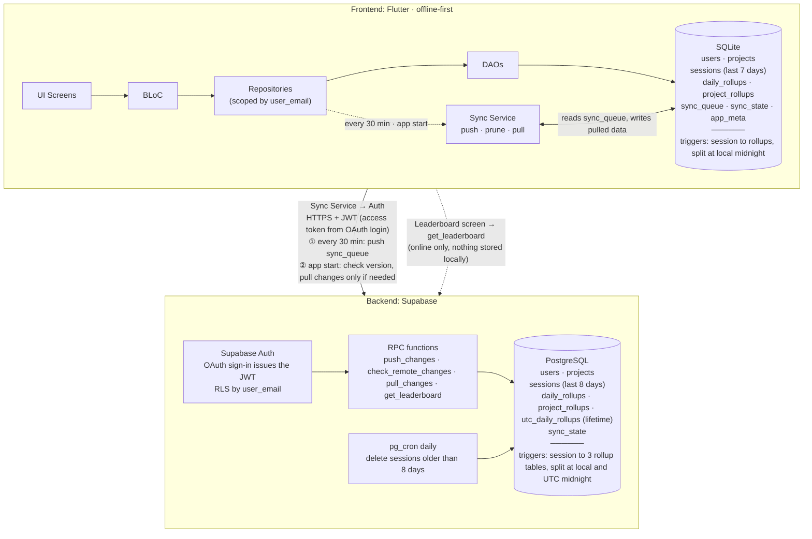
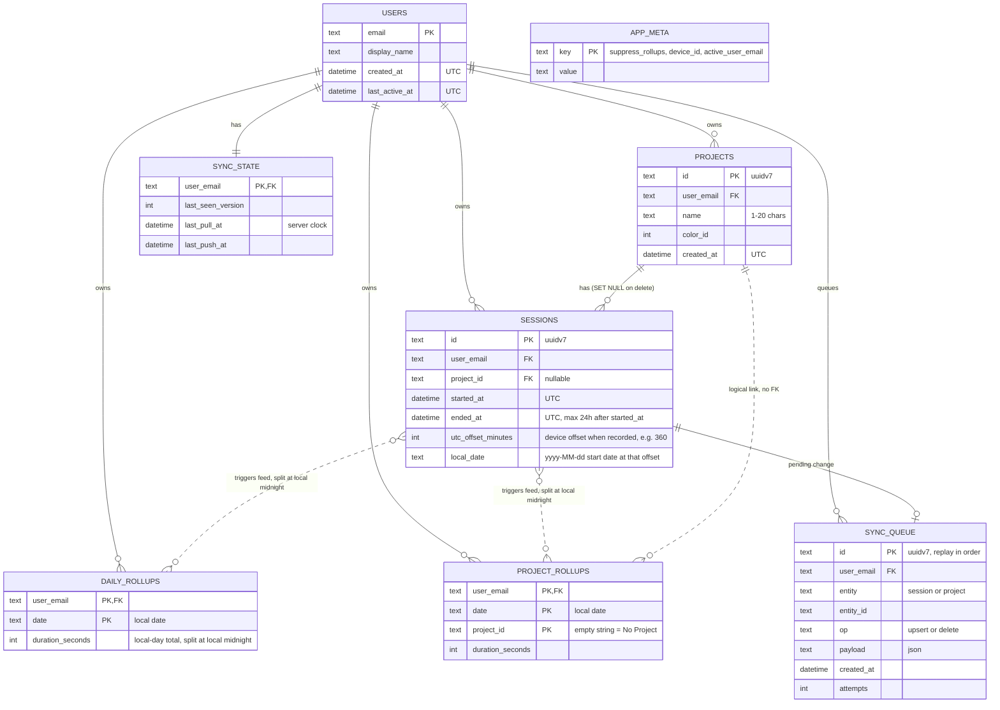
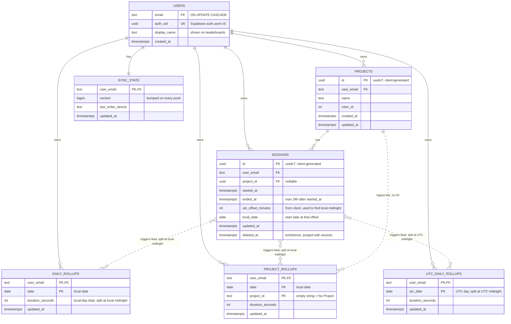

## Key conventions

- **IDs:** every primary key is a UUIDv7, generated on the client (`const Uuid().v7()`), except the `users` table (PK is the email) and the exceptions listed below. UUIDv7 is time-ordered, so inserts stay index-friendly and the queue replays in creation order.
- **Multiple accounts:** both SQLite and Postgres have a `users` table. Every other table carries `user_email`, and every query is scoped by the active account.
- **Two kinds of daily totals:**
  - `daily_rollups` holds **local-day** totals (the user's own timezone) for heatmaps, reports and streaks. It exists in SQLite and in the cloud.
  - `utc_daily_rollups` holds **UTC-day** totals for the international leaderboard. It exists in the cloud only and is maintained by cloud triggers.
- **Midnight splitting:** a session that crosses midnight is split, and each day receives only the seconds that fall inside it.
  - `daily_rollups` and `project_rollups` split at **local** midnight.
  - `utc_daily_rollups` splits at **UTC** midnight.
  - Example: a Dhaka session from 23:30 to 00:30 adds 30 min to each local day.
- **Timezone offset:** every session stores `utc_offset_minutes` (for example `+360`) from the moment it was recorded. SQLite and Postgres both use it to find local midnight, so they always agree, even if the phone's timezone changes later.
- **Session length cap:** a session lasts at most 24 hours, so it spans at most two local days and two UTC days. Every trigger therefore writes at most two slices.
- **Exceptions to the UUIDv7 rule:**
  - Rollup tables keep composite keys (for example `user_email + date`) because the triggers upsert on them.
  - `app_meta` is a key-value table.
  - `sync_state` is keyed by `user_email`, one row per account.

## Architecture Diagram

**Workflow**

1. **Write:** UI → BLoC → Repository → Drift DAO writes to SQLite for the active account. A trigger splits the session at local midnight and updates `daily_rollups` and `project_rollups` immediately, and the change is added to `sync_queue`.
2. **Read:** lists read `sessions` (last 7 days) and reports and heatmaps read lifetime rollups. Both come from local SQLite, so no network call is needed.
3. **Push (every 30 min):** the Sync Service sends the whole `sync_queue` in one batch. The cloud upserts by UUID (safe to retry), its triggers split the session and update the cloud rollups (local-day, project and UTC-day), and `sync_state.version` is bumped.
4. **Prune (after a successful push):** local sessions older than 7 days are deleted, but only if they were already pushed. `suppress_rollups=1` stops the triggers from touching the rollups, because the day totals were already counted.
5. **Pull (app start):** the app first pushes any pending `sync_queue` rows, then compares the cloud `sync_state.version` with its stored value. It only downloads data if another device wrote or this is a new device.
   - The pull fetches the full project list (a few rows) and removes local projects that no longer exist.
   - Pulled sessions (last 7 days) are inserted with `suppress_rollups=1`, because a session that started just before the window can spill into it. The cloud rollups are the source of truth for those days.
   - Rollup rows changed since the last pull are applied as authoritative values, for any date.
   - Pulled data is stored on top of what is already local, so it is never downloaded twice.
6. **Cloud prune (daily):** `pg_cron` deletes sessions older than 8 days. Rollups are kept forever.
7. **Leaderboard:** the `get_leaderboard` RPC reads `utc_daily_rollups` for a UTC date (or range) and returns the top N plus the caller's own rank, with display names instead of emails. Nothing is downloaded or stored locally for it.

**In plain words**

When a tracked session is finished, the UI hands it to the BLoC. The BLoC passes it to the repository, and the repository uses the DAOs to write it into the local SQLite database. As soon as the row lands in SQLite, database triggers split it at local midnight and add the seconds to `daily_rollups` and `project_rollups`, so heatmaps and reports update instantly without scanning sessions. The DAO also adds a note to `sync_queue` saying "this session still has to go to the cloud". None of this needs internet.

Every 30 minutes the Sync Service wakes up, reads the notes in `sync_queue` and sends them to Supabase in one request over HTTPS with the user's JWT. Supabase checks the login and runs `push_changes`, which saves the sessions in PostgreSQL. Cloud triggers then split each session again (at local midnight and at UTC midnight) and update `daily_rollups`, `project_rollups` and `utc_daily_rollups`. When the cloud confirms, the Sync Service clears those notes from `sync_queue`.

After a successful push, the app deletes sessions older than 7 days from SQLite. The rollups stay, so lifetime totals are never lost. The cloud does the same once a day for sessions older than 8 days.

When the app opens, it first pushes anything still waiting, then asks the cloud one tiny question: "did another device write since I last looked?" If not, nothing is downloaded. If yes, or if this is a new device, it downloads only what changed since last time and stores it on top of what SQLite already has, so the same data is never downloaded twice.

The leaderboard is the only screen that talks to the cloud directly. It asks `get_leaderboard`, shows the answer, and saves nothing locally.

**Reading the diagram**

- There are only two databases. **SQLite** is the database the app uses all day: every screen reads and writes it, and it works fully offline. **PostgreSQL** is the shared copy in the cloud: it is the backup, it joins data from multiple devices, and it is the only place UTC totals and the leaderboard exist.
- If the two ever disagree, the cloud rollups win, because the cloud has seen every device. The phone only talks to the cloud through the Sync Service (and the leaderboard screen).

## Local ER diagram (SQLite)

**Workflow**

- `users` holds every account that has signed in on this device. Projects, sessions, rollups, the queue and the sync cursor all belong to a `user_email`.
- A session is written once with its `utc_offset_minutes`. Triggers split it at local midnight and add each day's seconds to `daily_rollups` and `project_rollups`, so reports never scan sessions.
- `local_date` is the local start date of the session. It is only used for the 7-day window and list ordering.
- Sessions older than 7 days are pruned, but the rollups stay for the lifetime of the account.
- `sync_queue` holds changes waiting for the next push.
- `sync_state` stores, per account, the last cloud version seen and the last pull time.
- `app_meta` holds device-wide flags (`suppress_rollups`, `device_id`, `active_user_email`).
- There is no UTC table locally. UTC totals only matter for the leaderboard, which the cloud computes.

## Server ER diagram (PostgreSQL)

**Workflow**

- `users` mirrors the app's accounts. It links to Supabase Auth through `auth_uid`, and RLS compares `user_email` with the email claim in the JWT, so each account only sees its own rows.
- `push_changes` upserts projects and sessions in one transaction (sessions first, then project deletes), and triggers update the rollups.
- Deleting a project is a hard delete. A `BEFORE DELETE` trigger merges that project's rollups into the `''` (No Project) bucket.
- Sessions carry `deleted_at` tombstones so other devices learn about deletions. They are purged with the session.
- Each session feeds three rollup tables, and a session that crosses midnight adds one slice per day:
  - `daily_rollups` and `project_rollups` are split at local midnight, which the trigger finds from `utc_offset_minutes`.
  - `utc_daily_rollups` is split at UTC midnight.
- The daily prune deletes sessions older than 8 days (a one-day buffer for timezones). The delete triggers skip the subtraction while `app.pruning = on`, so rollups stay forever.
- `sync_state.version` is bumped on every push. Devices compare it to decide whether to pull, and the check costs a few bytes.
- `get_leaderboard` reads `utc_daily_rollups` and exposes `display_name` instead of the email.

