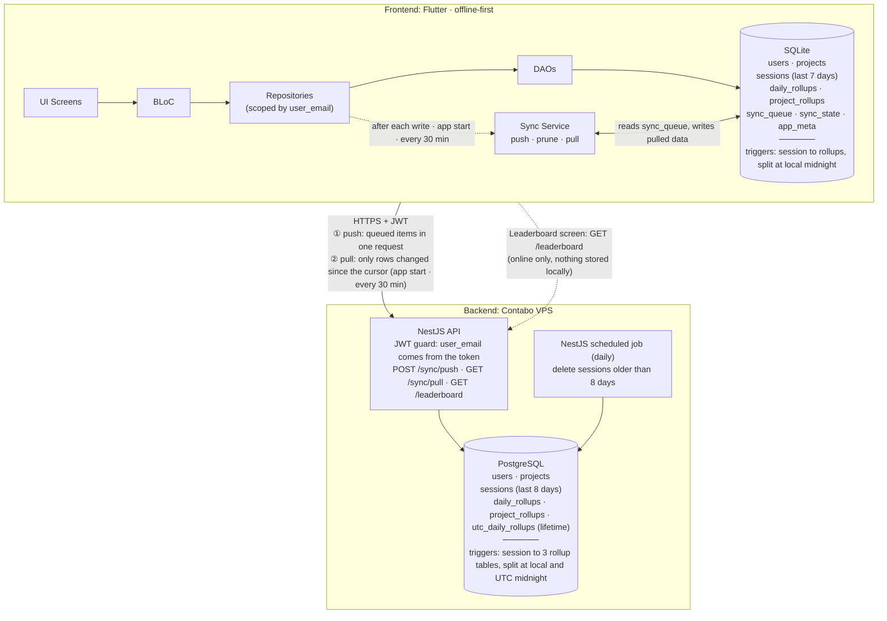
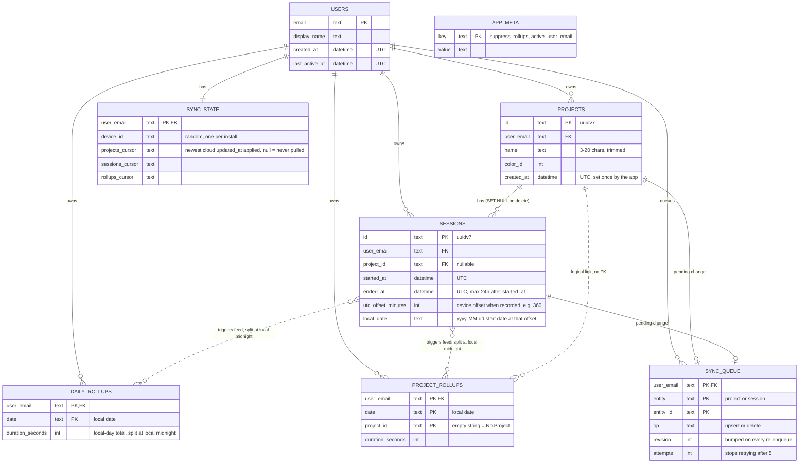
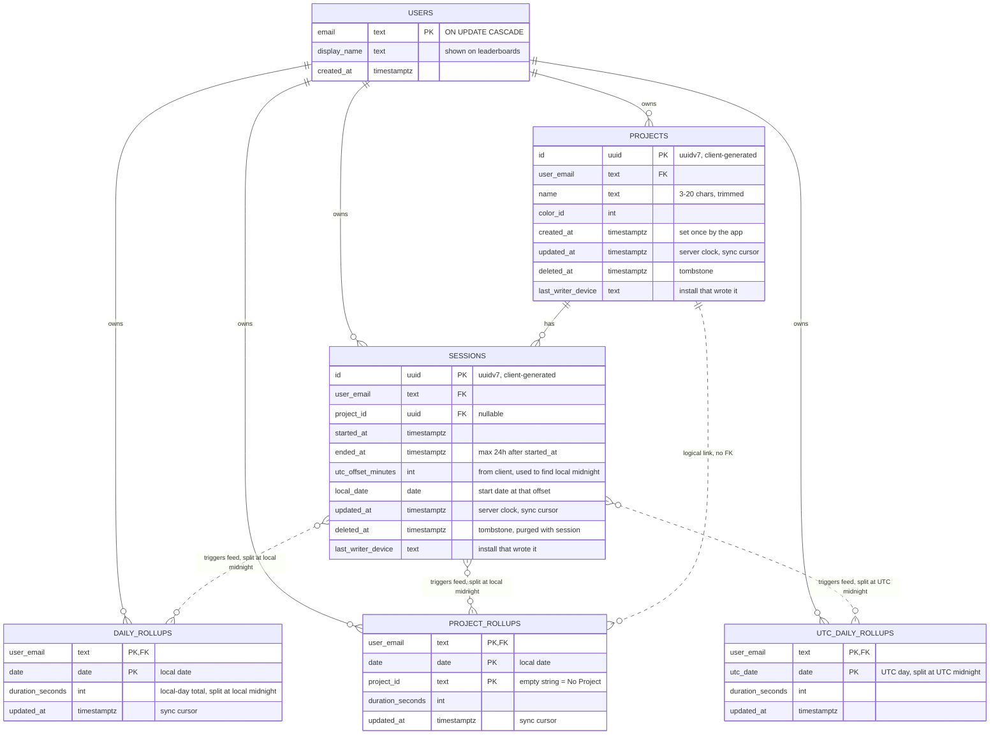

# Tarkeez

Offline-first Flutter app. Every action is saved to local SQLite first and synced to the cloud in the background, so the UI never waits for the network.

- **App:** Flutter · BLoC · Drift (SQLite) · GetIt · GoRouter
- **Backend:** NestJS + PostgreSQL on a Contabo VPS, served over HTTPS
- **Auth:** Google Sign-In. NestJS verifies the Google ID token and issues its own JWT, which every request carries.

> **Status:** projects sync is the first phase. Sessions, rollups and the leaderboard follow the same pattern and are described here as the target design.

## Key conventions

- **IDs:** every primary key is a UUIDv7, generated on the client (`const Uuid().v7()`), except the `users` table (PK is the email) and the exceptions listed below. UUIDv7 is time-ordered, so inserts stay index-friendly and lists can use `id` as a tiebreaker.
- **Multiple accounts:** both SQLite and Postgres have a `users` table. Every other table carries `user_email`, and every query is scoped by the active account. On the server, NestJS takes the email from the verified JWT and adds it to every query, so a client can never read or write another account's rows.
- **Server clock:** every synced cloud table has an `updated_at` that Postgres sets itself, never the phone. It is the only thing sync cursors are based on.
- **Two kinds of daily totals:**
  - `daily_rollups` holds **local-day** totals (the user's own timezone) for heatmaps, reports and streaks. It exists in SQLite and in the cloud.
  - `utc_daily_rollups` holds **UTC-day** totals for the international leaderboard. It exists in the cloud only and is maintained by cloud triggers.
- **Midnight splitting:** a session that crosses midnight is split, and each day receives only the seconds that fall inside it.
  - `daily_rollups` and `project_rollups` split at **local** midnight.
  - `utc_daily_rollups` splits at **UTC** midnight.
  - Example: a Dhaka session from 23:30 to 00:30 adds 30 min to each local day.
- **Timezone offset:** every session stores `utc_offset_minutes` (for example `+360`) from the moment it was recorded. SQLite and Postgres both use it to find local midnight, so they always agree, even if the phone's timezone changes later.
- **Session length cap:** a session lasts at most 24 hours, so it spans at most two local days and two UTC days. Every trigger therefore writes at most two slices.
- **Exceptions to the UUIDv7 rule:**
  - Rollup tables keep composite keys (for example `user_email + date`) because the triggers upsert on them.
  - `sync_queue` is keyed by `user_email + entity + entity_id` (one row per item).
  - `sync_state` is keyed by `user_email`, one row per account.
  - `app_meta` is a key-value table.

## How sync works

- **One queue row per item.** Every local write saves the data and upserts a `sync_queue` row in the same transaction, so a change can never be saved without being queued. Editing the same project five times offline leaves one row. The row stores only `entity + id + op`; the push reads the current data, so it always sends the latest version. Each re-enqueue bumps `revision`, so a change made during a push is never lost.
- **Push** sends the queued items in one request. It runs 2 seconds after any write (bursts collapse into one), at app start, and every 30 minutes. If the queue is empty, no request is made.
- **Pull** runs at app start and every 30 minutes, always after a push. It is a **delta pull**: the app sends a cursor per entity (the newest `updated_at` it has applied) and its `device_id`, and the server returns only rows changed since that cursor and **not written by that device**. When nothing changed, the answer is an empty list.
- **Own writes never come back.** Every write is stamped with the install's `device_id` (`last_writer_device` in the cloud), and the pull skips rows written by the asking device.
- **New device or reinstall:** the cursor is empty, so the first pull downloads everything once (500 rows per page, tombstones skipped). Every later pull is a delta.
- **Deletes:** local deletes are normal hard deletes. In the cloud, projects and sessions are soft-deleted (`deleted_at`) so other devices learn about it from the next pull.
- **Conflicts:** the last push wins. A save always clears `deleted_at`, so an edit beats a delete made on another device. A pull never overwrites a row that still has an unsynced local change.
- **Rejected items:** the server validates each item (for example project name 3 to 20 characters, trimmed) and reports rejected ones. The app retries them up to 5 times, then leaves them in the queue unsent.

| Moment                   | Network                                                |
| ------------------------ | ------------------------------------------------------ |
| Create, edit or delete   | One push of the changed item, no pull                  |
| App start, every 30 min  | Push (only if the queue is not empty) + one delta pull |
| Nothing changed anywhere | Push skipped, pull returns `[]`                        |
| New device               | One-time full download                                 |

## Architecture Diagram

**Workflow**

1. **Write:** UI → BLoC → Repository → Drift DAO writes to SQLite for the active account. For a session, a trigger splits it at local midnight and updates `daily_rollups` and `project_rollups` immediately. The change is added to `sync_queue` in the same transaction.
2. **Read:** lists read `sessions` (last 7 days) and `projects`; reports and heatmaps read lifetime rollups. All of it comes from local SQLite, so no network call is needed.
3. **Push:** the Sync Service sends the queued items to `POST /sync/push`. The server applies them in one transaction, upserting by UUID (safe to retry). For sessions, cloud triggers split them and update the cloud rollups (local-day, project and UTC-day). The server answers with the rejected items, if any. Accepted items are cleared from `sync_queue`.
4. **Prune (after a successful push):** local sessions older than 7 days are deleted, but only if they were already pushed. `suppress_rollups=1` stops the triggers from touching the rollups, because the day totals were already counted.
5. **Pull (`GET /sync/pull`):** the delta pull described above.
   - Changed projects are applied directly; tombstones delete the local project.
   - Pulled sessions (last 7 days) are inserted with `suppress_rollups=1`, because a session that started just before the window can spill into it. The cloud rollups are the source of truth for those days.
   - Changed rollup rows are applied as authoritative values, except for days that still have an unsynced local session.
   - Pulled data is stored on top of what is already local, and the cursors move forward, so nothing is downloaded twice.
6. **Cloud prune (daily):** a NestJS scheduled job deletes sessions older than 8 days, tombstones included. Rollups are kept forever.
7. **Leaderboard:** `GET /leaderboard` reads `utc_daily_rollups` for a UTC date (or range) and returns the top N plus the caller's own rank, with display names instead of emails. Nothing is downloaded or stored locally for it.

**In plain words**

When something is saved, the UI hands it to the BLoC, the repository writes it to SQLite, and a note goes into `sync_queue`. None of this needs internet, and for sessions, database triggers update the day totals instantly.

A couple of seconds after a change, and again at app start and every 30 minutes, the Sync Service sends the queued notes to the NestJS API in one request. At app start and every 30 minutes it then asks one more question: "what changed since my cursor that I didn't write myself?" Usually the answer is nothing.

After a successful push, the app deletes sessions older than 7 days from SQLite. The rollups stay, so lifetime totals are never lost. The cloud does the same once a day for sessions older than 8 days.

**Reading the diagram**

- There are only two databases. **SQLite** is the database the app uses all day: every screen reads and writes it, and it works fully offline. **PostgreSQL** is the shared copy in the cloud: it is the backup, it joins data from multiple devices, and it is the only place UTC totals and the leaderboard exist.
- If the two ever disagree, the cloud rollups win, because the cloud has seen every device. The phone only talks to the cloud through the Sync Service (and the leaderboard screen).

## Local ER diagram (SQLite)

**Workflow**

- `users` holds every account that has signed in on this device. Projects, sessions, rollups, the queue and the sync state all belong to a `user_email`.
- A session is written once with its `utc_offset_minutes`. Triggers split it at local midnight and add each day's seconds to `daily_rollups` and `project_rollups`, so reports never scan sessions.
- `local_date` is the local start date of the session. It is only used for the 7-day window and list ordering.
- Sessions older than 7 days are pruned, but the rollups stay for the lifetime of the account.
- `sync_queue` holds one row per item with a change waiting for the next push.
- `sync_state` stores, per account, this install's `device_id` and one pull cursor per entity (empty means "never pulled").
- `app_meta` holds device-wide flags (`suppress_rollups`, `active_user_email`).
- There is no UTC table locally. UTC totals only matter for the leaderboard, which the cloud computes.

## Server ER diagram (PostgreSQL)

**Workflow**

- `users` mirrors the app's accounts, keyed by email. NestJS reads the email from the verified JWT and scopes every query with it.
- `POST /sync/push` upserts projects and sessions in one transaction (sessions first, then project deletes). Triggers update the rollups.
- `updated_at` is set by Postgres on every insert and update. It is the sync cursor for projects, sessions and rollups.
- `last_writer_device` records which install wrote a row, so that device's pull can skip it. It is never sent back to the app.
- Deleting a project is a soft delete (`deleted_at`). A trigger moves that project's rollups into the `''` (No Project) bucket and clears `project_id` on its sessions. Project tombstones are kept for now.
- Sessions also carry `deleted_at` tombstones. They are purged together with the session.
- Each session feeds three rollup tables, and a session that crosses midnight adds one slice per day:
  - `daily_rollups` and `project_rollups` are split at local midnight, which the trigger finds from `utc_offset_minutes`.
  - `utc_daily_rollups` is split at UTC midnight.
- The daily prune deletes sessions older than 8 days (a one-day buffer for timezones). The delete triggers skip the subtraction while the prune runs, so rollups stay forever.
- `get_leaderboard` logic reads `utc_daily_rollups` and exposes `display_name` instead of the email.

## API

| Endpoint             | Purpose                                                                                       |
| -------------------- | --------------------------------------------------------------------------------------------- |
| `POST /auth/google`  | Verify the Google ID token, return an access and a refresh JWT                                |
| `POST /auth/refresh` | Return a new access token                                                                     |
| `POST /sync/push`    | Apply the queued items in one transaction, return the rejected ones                           |
| `GET /sync/pull`     | Return rows changed since each cursor, not written by the asking device (paged, 500 per page) |
| `GET /leaderboard`   | Top N plus the caller's own rank for a UTC date or range                                      |

## Planned

- **Free tier:** show only the two most recently created projects (`created_at` desc, `id` as tiebreaker, deleted ones excluded). Enforce it on the server too, because `created_at` comes from the phone's clock.
- **Project tombstone purge:** a scheduled job that deletes old tombstones, plus a rule that a device offline for longer than the purge window resets its cursors and reconciles against the full live list.
- **Sync on reconnect:** trigger a push when the network comes back, instead of waiting for the next write, app start or 30-minute tick.
- **Hosting:** HTTPS reverse proxy in front of NestJS, and a nightly PostgreSQL dump stored off the VPS.
