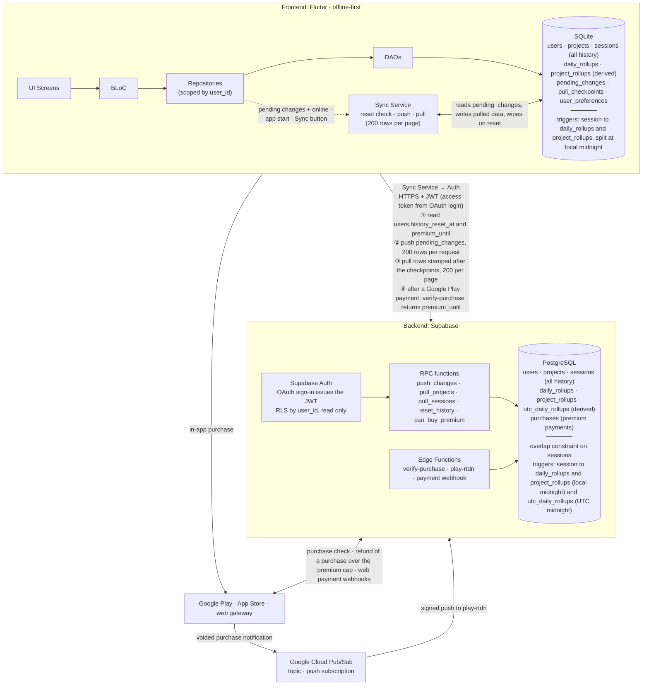
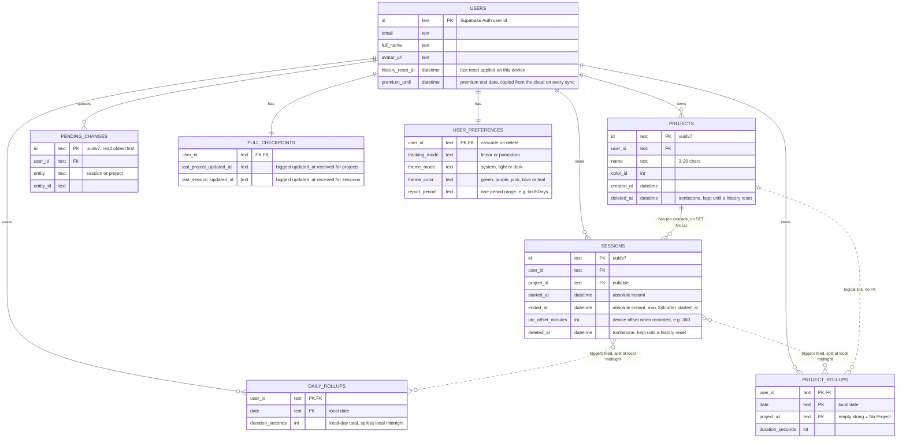
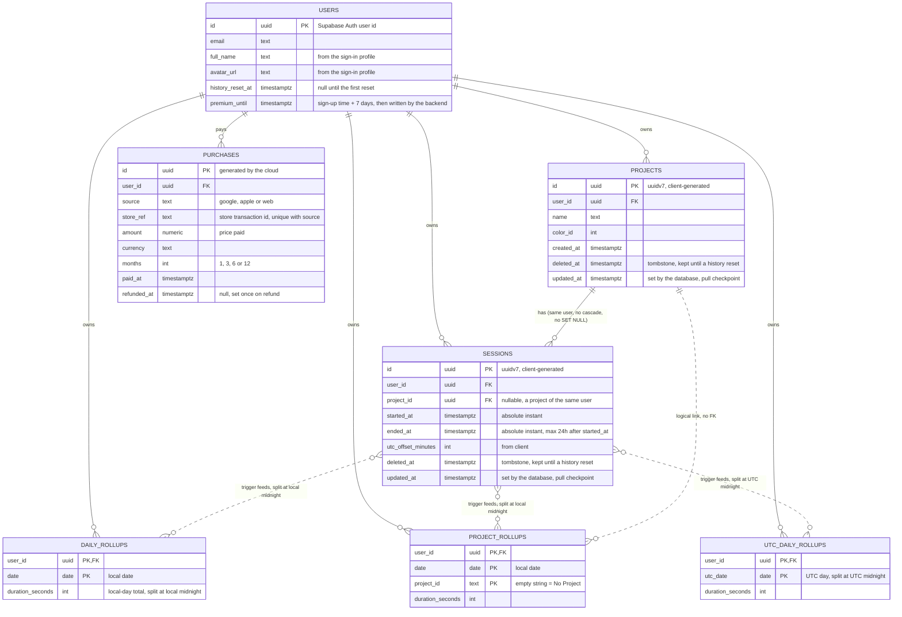

# Tarkeez: data and sync architecture

Tarkeez is offline-first. The app reads and writes a local SQLite database, and a sync layer copies changes to Supabase (PostgreSQL) in the background.

**Sessions are the source of truth.** Every session is kept, locally and in the cloud, until the user deletes all history. All totals (daily, per project, leaderboard, streak) are derived from sessions. Only three things sync: `users` (full name, history reset value and premium end date), `projects` and `sessions`.

**Premium is bought in Google Play, the App Store or on the web, and recorded in the cloud.** Each payment is a row in `purchases`, and `users.premium_until` is the date premium ends. Every device receives that date with its sync, so a plan bought on one platform works on all of them. Every new account starts with 7 days of premium. A refund removes the purchase's time again.

**Delete all history removes everything the user has**: projects, sessions and all rollups, in the cloud and on every device. The account (the `users` row), its premium and purchases, and each device's settings stay.

## Contents

1. [Key conventions](#key-conventions)
2. [How a session is split at midnight](#how-a-session-is-split-at-midnight)
3. [How sync works](#how-sync-works)
4. [Architecture diagram](#architecture-diagram)
5. [Local ER diagram (SQLite)](#local-er-diagram-sqlite)
6. [Server ER diagram (PostgreSQL)](#server-er-diagram-postgresql)
7. [Overlap rule](#overlap-rule)
8. [Editing and deleting](#editing-and-deleting)
9. [Rebuilding rollups](#rebuilding-rollups)
10. [Premium and purchases](#premium-and-purchases)
11. [Design notes](#design-notes)

## Key conventions

- **IDs:** primary keys are client-generated UUIDv7 (`const Uuid().v7()`). Exceptions:
  - `users.id` is the Supabase Auth user id, the same value locally and in the cloud.
  - Rollup tables use composite keys (for example `user_id + date`).
  - `pull_checkpoints` and `user_preferences` are keyed by `user_id`.
  - `purchases.id` is generated by the cloud, because only the backend creates purchases.
- **Accounts:** every table except `users` has `user_id`, and every query is scoped to the active account. In the cloud, RLS is `user_id = auth.uid()` and gives the app read access only. The app writes projects and sessions through `push_changes`, deletes history through `reset_history`, and updates only `full_name` and `avatar_url` on its own `users` row. Rollups, `purchases` and `premium_until` are written by triggers and backend functions.
- **What syncs:**

  | Table               | SQLite | PostgreSQL | Syncs?                                                                  |
  | ------------------- | ------ | ---------- | ----------------------------------------------------------------------- |
  | `users`             | Yes    | Yes        | Yes, cloud to device (`full_name`, `history_reset_at`, `premium_until`) |
  | `projects`          | Yes    | Yes        | Yes, both ways                                                          |
  | `sessions`          | Yes    | Yes        | Yes, both ways                                                          |
  | `daily_rollups`     | Yes    | Yes        | No. Each side derives its own from sessions                             |
  | `project_rollups`   | Yes    | Yes        | No. Each side derives its own from sessions                             |
  | `utc_daily_rollups` | No     | Yes        | No. Cloud only, derived from sessions                                   |
  | `purchases`         | No     | Yes        | No. Cloud only, written by the backend                                  |
  | `pending_changes`   | Yes    | No         | No. Local bookkeeping                                                   |
  | `pull_checkpoints`  | Yes    | No         | No. Local bookkeeping. Each device has its own position                 |
  | `user_preferences`  | Yes    | No         | No. Local only. Each device has its own settings                        |

- **Time:** `started_at` and `ended_at` are absolute instants. `utc_offset_minutes` is the device's offset when the session was recorded. Local time is `started_at + utc_offset_minutes`. Sessions store no date column. Calendar dates exist only in the rollup tables, and UTC dates only in `utc_daily_rollups`.
- **Daily totals:**
  - `daily_rollups`: local-day totals. Stored locally (heatmaps, reports, streaks) and in the cloud (streak leaderboard).
  - `project_rollups`: local-day totals per project. Stored locally (project charts) and in the cloud.
  - `utc_daily_rollups`: UTC-day totals for the time leaderboard. Cloud only.
- **Session length cap:** at most 24 hours, so a session touches at most two local days and two UTC days, and each trigger writes at most two slices per table.
- **No future sessions:** a session cannot end in the future. The app refuses one that ends more than 1 minute after the device clock. `push_changes` does not answer one that ends more than 10 minutes after the cloud clock, so it stays in `pending_changes` and is retried at the next sync (see "Special situations").
- **No future projects:** the same rule applies to a project's `created_at`. `push_changes` does not answer a project created more than 10 minutes after the cloud clock, so it stays in `pending_changes`.
- **Daily limits:** per user and per UTC day, the cloud stores at most 75 new sessions (by `started_at`) and 10 new projects (by `created_at`). Deleted rows count, because they stay in the table. The app checks the same limit before saving, refuses the row and shows a warning. A row over the limit that still reaches the cloud is rejected and not stored.
- **Age limit:** `push_changes` rejects a new project or session dated more than 33 days before today's UTC midnight. Edits and deletes of rows the cloud already has are never rejected for age. The device removes a rejected row locally, together with the sessions of a rejected project, and rebuilds its rollups.
- **Immutable sessions:** a saved session only changes by getting `deleted_at`, and that is one-way. Triggers react only to an insert and to `deleted_at` being set. Projects can be edited.
- **No overlapping sessions:** a user never has two live sessions that overlap in time, even across devices. The cloud keeps the longest and drops the other (see "Overlap rule").
- **Tombstones:** a normal delete never removes a row. Projects and sessions get `deleted_at`, which syncs like any other change. Only "Delete all history" and "Delete account" hard-delete rows (see "Editing and deleting").
- **History reset:** `users.history_reset_at` is null until the first "Delete all history". A reset hard-deletes the user's projects, sessions and rollups in the cloud and stamps this value. Every device wipes its own copy when it sees a newer value than its own.
- **Premium:** `users.premium_until` is the date premium ends. A new account starts with 7 days of premium. The value is derived from that trial and from `purchases`, and it is written only by the backend. It never passes 740 days from now. Each device copies it on every sync, and premium is active while `premium_until > now` (see "Premium and purchases").
- **Foreign keys:** every `user_id` foreign key cascades on delete, locally and in the cloud, so deleting an account deletes everything it owns (see "Delete account"). A project row is never removed except by a history reset or an account deletion, so `project_id` on a session always resolves. There is no cascade or `SET NULL` from projects to sessions. A reset deletes sessions before projects, locally and in the cloud. In the cloud a session can only use a project of its own user, because the foreign key is `(project_id, user_id)`. A session whose project is deleted counts as "No Project" when read.
- **Page size:** a push or a pull moves at most 200 rows per request, and the app reads, writes and binds at most 200 rows at a time. A device that was offline for years syncs in many small pages (see "Pages of 200 rows").
- **Pull checkpoint:** the database stamps every project and session with `updated_at` whenever it is added or changed. Each device stores the biggest stamp it has received, one for projects and one for sessions, in `pull_checkpoints`. A pull asks for rows stamped after the checkpoint, starting 2 minutes before it (safety rule 5).
- **Sync trigger:** there is no timer. Sync runs when `pending_changes` has rows and the device is online, at app start, and when the user taps the Sync button (see "When sync runs").
- **Storage:** about 0.5 KB per session including indexes. At 500 sessions a month that is about 250 KB per user per month, or 3 MB per user per year. Rollups add a few KB per user per year.

## How a session is split at midnight

### Stored values

```
started_at           absolute instant
ended_at             absolute instant, at most 24 h after started_at
utc_offset_minutes   the device's offset from UTC when recorded, e.g. +360
```

### Instants and wall-clock time

- An **instant** is one exact moment, like "21:00 UTC on Oct 23". Every timezone agrees on it.
- A **wall-clock time** is what a local clock showed, like "22:00". Without a timezone it is not a single moment.

The app stores the instant and the offset, and calculates local time when needed:

```
local time = started_at + utc_offset_minutes
```

Instants are used because overlap checks, durations and ordering need one common timeline. A phone in Dhaka (UTC+6) that recorded 22:00 to 23:00 and a device at UTC+0 that recorded 16:30 to 17:30 look unrelated as wall-clock numbers, but they overlap by 30 minutes in real time. Wall-clock times are also ambiguous when daylight saving repeats an hour.

### One function, two calls

```
split(start, end, offset):
  shift both ends by the offset
  cut at every 24-hour boundary on the shifted timeline
  return one slice per day touched      (at most two)

daily_rollups, project_rollups : split(started_at, ended_at, utc_offset_minutes)
utc_daily_rollups              : split(started_at, ended_at, 0)
```

The two splits are independent, and each adds up to the full session length.

### Example: a session that crosses both midnights

A 4-hour session on a device at UTC+1 (`utc_offset_minutes = 60`), started at 22:00 local on Oct 23. Local midnight is 2 hours in, and UTC midnight is 3 hours in. Stored values:

```
started_at           = Oct 23, 21:00 UTC
ended_at             = Oct 24, 01:00 UTC
utc_offset_minutes   = 60
```

| Moment                     | UTC           | Local (UTC+1) |
| -------------------------- | ------------- | ------------- |
| Start                      | Oct 23, 21:00 | Oct 23, 22:00 |
| 2 h in: **local midnight** | Oct 23, 23:00 | Oct 24, 00:00 |
| 3 h in: **UTC midnight**   | Oct 24, 00:00 | Oct 24, 01:00 |
| End                        | Oct 24, 01:00 | Oct 24, 02:00 |

```
time (UTC)  21:00     22:00     23:00     00:00     01:00
              ├─────────┼─────────┼─────────┼─────────┤
local time  22:00     23:00     00:00     01:00     02:00

UTC days      │        Oct 23 · 3 h         │Oct 24·1h│
local days    │   Oct 23 · 2 h    │   Oct 24 · 2 h    │
```

| Rollup table        | Cut at         | Oct 23   | Oct 24  | Total    |
| ------------------- | -------------- | -------- | ------- | -------- |
| `daily_rollups`     | local midnight | 7,200 s  | 7,200 s | 14,400 s |
| `project_rollups`   | local midnight | 7,200 s  | 7,200 s | 14,400 s |
| `utc_daily_rollups` | UTC midnight   | 10,800 s | 3,600 s | 14,400 s |

The local split shifts the session by the offset (21:00 to 01:00 becomes 22:00 to 02:00) and cuts at 00:00. The UTC split cuts the stored instants at 00:00 UTC.

### Edge cases

- **Both midnights in one session:** a session contains both only if it is longer than the gap between them, which equals the offset's distance from UTC: 1 hour for UTC+1, 6 hours for Dhaka (UTC+6).
- **Deleting a session** recomputes the same slices and subtracts them. A tombstone that arrives already deleted adds nothing.
- **Daylight saving:** one offset is stored per session. If the clocks change mid-session, the split uses the start offset, so that session's day boundary can be off by up to one hour.
- **Ending exactly at midnight** produces no empty slice for the next day.

## How sync works

A sync run **checks for a reset, then pushes, then pulls**.

- **Reset check:** read the device's own `users` row and copy `full_name` and `premium_until` from it to the local row. `premium_until` is replaced, not merged, so it can go down (for example after a refund). If `history_reset_at` is newer than the local value, wipe all local projects, sessions, rollups, pending changes and checkpoints (see "Delete all history"). Nothing from before the reset is pushed.
- **Push:** send the rows listed in `pending_changes`, 200 at a time, projects first, then sessions, until the queue is empty.
- **Pull:** fetch every project and session stamped after the device's checkpoints, 200 at a time, projects first, until a page comes back with fewer than 200 rows.

### When sync runs

There is no timer. Sync starts only on one of these three events, and only while the device is online:

| Event                          | Run                                                          |
| ------------------------------ | ------------------------------------------------------------ |
| `pending_changes` is not empty | reset check, push, then pull                                 |
| App start                      | reset check, push (if `pending_changes` has rows), then pull |
| Sync button                    | reset check, push (if `pending_changes` has rows), then pull |

`pending_changes` is not empty covers two cases: a change is added while the device is online (session finished, project edit, delete), and the connection returns while changes are waiting.

- **App start while offline:** the sync runs when the connection returns.
- **Offline:** changes wait in `pending_changes` and no attempt is made. A sync starts when the connection returns.
- **Failed push:** the rows stay in `pending_changes` and are retried at the next event above. Nothing retries on a timer.
- **No pending changes:** the device does not poll. It receives other devices' changes (and resets) at app start, on the Sync button, or in the sync that follows its own next change.
- **Overlapping events:** events that arrive while a run is in progress are merged into one follow-up run.

### Pages of 200 rows

Supabase returns at most 1,000 rows per request, and SQLite binds at most about 32,000 values in one statement. Sync stays far below both: a request carries at most 200 rows, and every local read or write handles at most 200 rows.

**Push.** The queue is read in pages, oldest first:

1. Read the next 200 entries of `pending_changes` after the cursor (the id of the last entry read).
2. Group them by row id, because several edits of one project leave several entries, and read those rows (at most 200).
3. Send them in one `push_changes` request.
4. Remove the entries the cloud answered, whether applied, rejected or dropped.
5. Move the cursor and repeat until a page is empty.

- An entry the cloud did not answer stays in the queue. This covers a temporary error, a session whose project is not pushed yet, and a session that ends more than 10 minutes in the future. The cursor moves past it, so the loop always ends, and the next sync retries it.
- An entry added during the run has a bigger id, so the same run picks it up.
- If a request fails (the connection drops, for example), every later entry stays untouched. Pages already answered are gone from the queue, so the next sync continues where this one stopped.
- `push_changes` rejects a request with more than 200 rows in a list.

**Pull.** Pages are read by `(updated_at, id)`:

1. The first page starts 2 minutes before the checkpoint (safety rule 5). With no checkpoint it starts at the beginning.
2. Each next page starts after the last row of the previous one, by `updated_at` and then `id`, so rows with the same timestamp are never split or skipped.
3. The app saves each page in one transaction, moves the checkpoint, and asks for the next page.
4. A page with fewer than 200 rows is the last one.

`pull_projects` and `pull_sessions` never return more than 200 rows.

Example: a phone was offline for 5 years and holds 30,000 queued sessions. When the connection returns it sends 150 requests of 200 sessions. A new tablet pulls the same 30,000 sessions in 150 pages. Either sync can be interrupted and continues from the last finished page.

### Pieces

| Piece              | Where                           | Purpose                                                                                                                   |
| ------------------ | ------------------------------- | ------------------------------------------------------------------------------------------------------------------------- |
| `pending_changes`  | device                          | Rows changed locally and not yet pushed. Stores the table and id only. The row is read at push time.                      |
| `updated_at`       | cloud `projects` and `sessions` | Time the database last changed the row. A trigger sets it, so device clocks never matter.                                 |
| `pull_checkpoints` | device                          | Biggest `updated_at` received: `last_project_updated_at` and `last_session_updated_at`. One row per account.              |
| `history_reset_at` | `users`, cloud and device       | Time of the last "Delete all history". A device that sees a newer cloud value wipes its data.                             |
| `premium_until`    | `users`, cloud and device       | Date premium ends. The backend derives it from the trial and `purchases`, and the device replaces its copy on every sync. |

Pull query (200 rows per page, the same for sessions):

```sql
select * from projects
where user_id = :me and (updated_at, id) > (:after_stamp, :after_id)
order by updated_at, id limit 200;
-- first page of a pull: :after_stamp = checkpoint - 2 minutes
-- next pages: the updated_at and id of the last row received
-- after each page, move the checkpoint to the biggest updated_at received
```

Cloud sessions in `updated_at` order, with the phone's checkpoint:

```
 10:00 ■■■■■■■■■■  50 sessions  │  10:20 ■■■■■■  30 sessions
                                ▲
                 phone's checkpoint = 10:00
     next pull = everything right of 09:58 (checkpoint - 2 min)
```

When nothing changed, a pull still returns the newest row and every row stamped within 2 minutes before it. The device already has them, so saving them changes nothing. The `(user_id, updated_at)` indexes keep the request cheap.

### Example: phone, tablet and cloud

| Time  | Device | What happens                                                                                                                                                     | Rows downloaded | Checkpoint after |
| ----- | ------ | ---------------------------------------------------------------------------------------------------------------------------------------------------------------- | --------------- | ---------------- |
| 10:00 | Phone  | Connection returns with 50 pending sessions. Pushes them, stamped 10:00. Pulls with no checkpoint: gets its own 50 back.                                         | 50 (own)        | 10:00            |
| 10:10 | Tablet | App start on a new device, nothing to push. Pulls with no checkpoint: every row.                                                                                 | **50**          | 10:00            |
| 10:20 | Tablet | The 30 sessions recorded since are pending, so it pushes them, stamped 10:20. Pulls from 09:58 (checkpoint 10:00 minus 2 minutes): the 50 it has and its own 30. | 80 (30 own)     | 10:20            |
| 10:30 | Phone  | App start, nothing pending. Pulls from 09:58: its own 50 and the tablet's 30.                                                                                    | 80 (**30 new**) | 10:20            |
| 10:40 | Tablet | Sync button, nothing pending. Pulls from 10:18: the 30 stamped 10:20, which it already has.                                                                      | 30 (none new)   | 10:20            |

Both devices end with the same 80 sessions. The phone downloaded 80 rows, and 30 of them were new to it.

### Edits, deletes and overlap drops

Every other change uses the same path. The cloud re-stamps the row, so it falls after every device's checkpoint and is pulled.

| Change                                 | Cloud                                     | Other devices                                                                   |
| -------------------------------------- | ----------------------------------------- | ------------------------------------------------------------------------------- |
| Phone renames a project at 11:00       | Replaces the row, stamps 11:00            | The tablet's next pull returns the project and saves the new name               |
| Tablet deletes a session at 11:05      | Sets `deleted_at`, stamps 11:05           | The phone's next pull returns the tombstone, and its trigger subtracts the time |
| Overlap makes the cloud drop a session | Sets `deleted_at` on the loser, stamps it | Every device, including the one that recorded it, pulls the tombstone           |

### Rows that arrive twice

A device can receive rows it already has: its own rows right after a push, and rows repeated by the overlap (rule 5 below). This is safe:

- Rows are saved with an **upsert by id**, so there are no duplicates.
- A session never changes after it is saved, so the repeat is identical.
- Triggers react only to a new row or to the first `deleted_at`, so nothing is counted twice.

### Safety rules

1. **A pull never overwrites a row that still has an entry in `pending_changes`.** That row has an unpushed edit. The next push settles it (last push wins).
2. **A tombstone is one-way.** When saving a pulled row, an existing `deleted_at` is kept, so a stale copy never revives a deleted row.
3. **Work in pages and save progress after each page.** A pull saves the checkpoint after each page, and a push removes the answered entries after each page, so a failure repeats at most one page.
4. **A checkpoint only moves forward.**
5. **Overlap for late commits:** a pull asks for `updated_at > checkpoint - 2 minutes`. A row's `updated_at` is the time its transaction started, but other devices see the row only when it commits, so a slow push can commit after a faster one that started later. Example: the phone starts pushing 200 sessions at 10:00:00 and commits at 10:00:03. The tablet starts at 10:00:01 and commits at 10:00:01.2. A laptop that pulls at 10:00:02 sees only the tablet's row and moves its checkpoint to 10:00:01. Without the overlap, the phone's rows (stamped 10:00:00) would never reach the laptop. Supabase stops a request that runs longer than the statement timeout (8 seconds by default for signed-in users), so a late commit always falls inside the 2 minutes.
6. **Reset check before push.** A device that missed a reset wipes itself before it sends anything, so rows from before the reset never reach the cloud.

### Special situations

| Situation                                       | Behaviour                                                                                                                                                                                                                                                                                                                     |
| ----------------------------------------------- | ----------------------------------------------------------------------------------------------------------------------------------------------------------------------------------------------------------------------------------------------------------------------------------------------------------------------------- |
| Changes made while offline                      | Rows wait in `pending_changes`, and no attempt is made. A sync starts when the connection returns.                                                                                                                                                                                                                            |
| Offline for years                               | The queue holds thousands of entries. It is pushed 200 rows per request, oldest first, and each page leaves the queue when the cloud answers, so an interrupted sync continues where it stopped.                                                                                                                              |
| New phone, reinstall, or cleared app storage    | No checkpoint, so the first pull returns everything, 200 rows per request. This restores the history once (about 3 MB per year of history). Settings start with default values, because they do not sync. `premium_until` comes back with the first sync.                                                                     |
| Second account on the same device               | Rows, checkpoints and settings are per `user_id`, so accounts never mix. Each account keeps its own theme, tracking mode and period ranges.                                                                                                                                                                                   |
| Offline for a week                              | The checkpoint is a week old, so the next pull returns the week's changes, in pages.                                                                                                                                                                                                                                          |
| Two devices edit the same project offline       | Last push wins for the whole row. The other device pulls the winning version on its next sync.                                                                                                                                                                                                                                |
| "Delete all history" on another device          | The device's next sync reads a newer `history_reset_at` on its `users` row, before it pushes. It wipes its projects, sessions and rollups, clears its pending changes and checkpoints, and pulls from scratch.                                                                                                                |
| Device offline during a reset                   | Same as above. Everything the device recorded since the reset is wiped too, including rows still in `pending_changes`. If a stale push still reaches the cloud (a reset lands in the middle of a sync), `push_changes` rejects projects created before the reset and sessions that ended before it.                           |
| Session ends in the future (device clock ahead) | `push_changes` does not answer it. The row stays in `pending_changes`, and every sync retries it until it is no more than 10 minutes ahead of the cloud clock. Example: a phone whose clock is 1 hour ahead saves a session that ends at 14:00 when the real time is 13:00. The cloud saves it at the first sync after 13:50. |
| Offline for more than 33 days                   | At the first push, rows still in `pending_changes` that are dated more than 33 days back are rejected. The device deletes them, together with the sessions of a rejected project, and rebuilds its rollups. Rows already in the cloud are not affected.                                                                       |
| Daily limit reached                             | The app refuses a new session or project and shows a warning. Other devices count against the same limit, so a row over it is rejected by the cloud and removed from the device.                                                                                                                                              |

### Cost

A device downloads its own rows once after pushing them, and re-reads the rows stamped within 2 minutes before its checkpoint on every pull. That is about one extra copy of the user's data, roughly 3 MB per user per year, plus a few rows per sync.

## Architecture diagram

**Workflow**

1. **Write:** when a session is finished, UI → BLoC → Repository → Drift DAO writes it to `sessions` with its `utc_offset_minutes`. The repository first checks that the session lasts between 1 second and 24 hours and does not end in the future. Local triggers split it at local midnight and update `daily_rollups` and `project_rollups`. The DAO adds a row to `pending_changes`.
2. **Read:** session lists read `sessions`. Reports, heatmaps and streaks read the rollups. Theme, tracking mode and period ranges read `user_preferences`. Premium checks read `users.premium_until`. All reads are local.
3. **Sync starts** when `pending_changes` has rows and the device is online, at app start, or on the Sync button. If the device is offline, nothing is attempted. A sync begins with the reset check: the app reads its `users` row and copies `premium_until` to the local row. If `history_reset_at` is newer than the local value, it wipes local projects, sessions, rollups and pending changes, and clears its checkpoints.
4. **Push:** the Sync Service reads `pending_changes` 200 entries at a time and sends each page to `push_changes`, projects first, then sessions, until the queue is empty. The cloud upserts the rows by UUID (safe to retry). It rejects projects created before the last reset and sessions that ended before it, new rows that are too old or over the daily limit, and sessions whose project was rejected. It resolves overlaps (see "Overlap rule"). A session that ends more than 10 minutes in the future is not answered and stays pending. Cloud triggers update `daily_rollups`, `project_rollups` and `utc_daily_rollups`. The response lists which rows were applied, rejected and dropped, and the device applies that locally and removes the answered entries from the queue.
5. **Pull (right after every push):** the app calls `pull_projects`, then `pull_sessions`, 200 rows per page, starting 2 minutes before `last_project_updated_at` and `last_session_updated_at`, until a page has fewer than 200 rows. The app upserts each page and moves the checkpoint. Local triggers rebuild the rollups. No rollup is downloaded.
6. **Premium purchase:** the user taps Buy. The app tags the purchase with the signed-in user id and opens the Google Play sheet. After payment, the app sends the purchase token to `verify-purchase`. The function verifies it with Google Play, rejects it if it is tagged with another account, saves a row in `purchases`, updates `users.premium_until` and returns it. The app saves the value in the local `users` row of the account that sent the request. A purchase that was paid but not verified is retried by `restorePurchases` at app start and after every sign-in. A web payment reaches the cloud through the gateway webhook, and the device receives the value at its next sync.
7. **Refund:** Google Play sends a real-time developer notification (a voided purchase) to a Pub/Sub topic, and a push subscription delivers it to the `play-rtdn` Edge Function. The function checks the Pub/Sub signature and calls `refund_purchase`, which removes the purchase's time from `premium_until`. Each device receives the new date at its next sync.

**In plain words**

A finished session is written to SQLite. Triggers add its seconds to `daily_rollups` and `project_rollups` immediately, so reports update without scanning sessions, and a row is added to `pending_changes`. None of this needs internet.

When `pending_changes` has rows and the device is online, the Sync Service first reads the user's `users` row from Supabase over HTTPS with the user's JWT. If a history reset is newer than the one the device has applied, the device wipes its data. Then it sends the pending projects and sessions, 200 per request. If the device is offline, the rows wait and nothing is attempted until the connection returns. A sync also runs at app start and when the user taps the Sync button. There is no timer. The cloud keeps the longest session when two overlap, and its triggers add each kept session to `daily_rollups`, `project_rollups` and `utc_daily_rollups`. The app then downloads the rows stamped after its checkpoints, 200 per page. Pulled sessions go through the same local triggers as recorded ones.

Premium works separately from tracking. A new account starts with 7 days of premium. A payment made in Google Play, the App Store or on the web is verified by the backend, saved in `purchases` and added to `users.premium_until`. Every device copies that date with its sync, so a plan bought on one device unlocks all of them. A refund in Google Play reaches the cloud through a real-time developer notification and removes that purchase's time again.



## Local ER diagram (SQLite)

- `users` holds every account that has signed in on this device, created from the cloud `users` row at sign-in. `history_reset_at` is the last reset this device applied. `premium_until` is the premium end date, copied from the cloud on every sync. A new account arrives with its 7-day trial already in `premium_until`.
- Triggers on `sessions` split each session at local midnight into `daily_rollups` and `project_rollups`. They fire on insert and when `deleted_at` is first set. An insert that already has `deleted_at` (a pulled tombstone) adds nothing. Pulled rows are saved with upserts, never replace.
- `project_rollups` has no FK to projects. A project that is missing or has `deleted_at` set is counted as "No Project" (`''`) through the `project_rollups_effective` view.
- `pending_changes` lists the rows to push. It stores no copy of the data. Every change is an upsert, and a delete is `deleted_at` being set. Push reads it 200 entries at a time, oldest first, and removes the entries the cloud answered. A non-empty table is what starts a sync when the device is online.
- `pull_checkpoints` stores, per account, the biggest `updated_at` received for projects and for sessions. A pull asks for rows stamped after them, starting 2 minutes before.
- `user_preferences` holds one row per account on this device, created with default values the first time it is needed (`linear`, `system`, `green`, `last5Days`). It never syncs, so each device keeps its own settings. A history reset leaves it untouched, and deleting the `users` row deletes it.
- The enum columns of `user_preferences` are stored as text. `report_period` holds one period range: `today`, `yesterday`, `thisWeek`, `lastWeek`, `last3Days`, `last5Days`, `last7Days`, `last30Days`, `thisMonth`, `lastMonth`, `thisYear`, `lastYear`, `last12Months` or `allTime`.
- A history reset wipes the account's `sessions`, `projects`, `daily_rollups`, `project_rollups` and `pending_changes`, in that order for the first two (sessions point at projects), and clears both checkpoints. Triggers do not run for this wipe. `premium_until` is not touched.



## Server ER diagram (PostgreSQL)

- `users` is keyed by the Supabase Auth user id. `full_name` and `avatar_url` are filled from the sign-in profile when the account is created, and `full_name` is copied to the device on every sync. `history_reset_at` is null until the first "delete all history". Devices read it at the start of every sync. `premium_until` is set to the sign-up time + 7 days when the account is created, and after that only backend functions change it. Devices copy it on every sync.
- `purchases` has one row per payment. Only backend functions write it (see "Premium and purchases").
- `push_changes` takes at most 200 rows per list. It upserts projects first, then sessions. Each row runs in its own savepoint, so one failure does not fail the batch. A project upsert replaces the whole row (last push wins). Projects created before `history_reset_at` and sessions that ended before it are rejected. So are new rows older than 33 days or over the daily limit, and sessions whose project was rejected. A session that ends more than 10 minutes in the future is not answered and stays pending on the device. A session can only use a project of the same user. Overlaps follow the "Overlap rule".
- `pull_projects` and `pull_sessions` return one page of at most 200 rows, read by `(updated_at, id)` after the cursor the device sends.
- `reset_history` hard-deletes the user's `utc_daily_rollups`, `project_rollups`, `daily_rollups`, `sessions` and `projects` (in that order) and sets `history_reset_at = now()`, all in one transaction. Triggers do not run for these deletes. The `users` row, `purchases` and `premium_until` stay.
- Signed-in users can call `push_changes`, `pull_projects`, `pull_sessions`, `reset_history` and `can_buy_premium`. The sign-up, rollup, premium and purchase functions are callable only by the backend. Signed-out requests cannot read tables or call functions.
- Deleting the Auth user deletes the `users` row and everything it owns (see "Delete account").
- A trigger sets `updated_at = now()` on every insert or update of a project or session. Device checkpoints track it (see "How sync works").
- Each live session feeds three rollup tables, one slice per day touched (see "How a session is split at midnight"):
  - `daily_rollups`: split at local midnight using `utc_offset_minutes`. Powers the streak leaderboard.
  - `project_rollups`: split at local midnight using `utc_offset_minutes`, one row per project per day. A session with no project goes to `''` (No Project).
  - `utc_daily_rollups`: split at UTC midnight. Powers the time leaderboard.
- Triggers add when a live session is inserted and subtract when `deleted_at` is first set. A retried push cannot count twice.
- `project_rollups` has no FK to projects. A project that is missing or has `deleted_at` set is counted as "No Project" (`''`) through the `project_rollups_effective` view.
- Indexes: `sessions (user_id, updated_at)`, `sessions (user_id, started_at)`, `projects (user_id, updated_at)`, `projects (user_id, created_at)` and `purchases (user_id, paid_at)`. The `started_at` and `created_at` indexes serve the daily limit count.
- The cloud keeps no per-device state. Each device keeps its own position in `pull_checkpoints`.

```sql
create extension if not exists btree_gist with schema extensions;

-- Backstop only. push_changes resolves overlaps first (the longest session wins).
alter table sessions add constraint no_overlap
  exclude using gist (
    user_id with =,
    tstzrange(started_at, ended_at) with &&
  ) where (deleted_at is null);
```



## Overlap rule

A user never has two live sessions that overlap in time, even if two devices ran at once while offline. Only finished sessions are pushed, so a running timer never conflicts. Until a device syncs it cannot know about an overlap, so its totals may briefly count both sessions.

`push_changes` handles each pushed session in four steps:

1. Find the user's live sessions that overlap it.
2. If there are none, insert it.
3. If it is **longer than every session it overlaps**, set `deleted_at` on those sessions and insert it. A tie goes to the earlier `started_at`, then to the lower id.
4. Otherwise it loses and is stored with `deleted_at` already set. The tombstone makes a retry a no-op and keeps every device consistent.

Nothing is trimmed: the loser's time leaves the totals. The change reaches every device like this:

- Cloud triggers subtract the dropped sessions from `daily_rollups`, `project_rollups` and `utc_daily_rollups`.
- A pushed session that lost is reported in the `push_changes` response, and the pushing device sets `deleted_at` on its local copy immediately.
- Every dropped session gets a fresh `updated_at`, so every device, including the one that recorded it, pulls the tombstone on its next sync and subtracts the time.

The exclusion constraint on `sessions` is a backstop. A bug in `push_changes` cannot leave overlapping live sessions in the database.

## Editing and deleting

**Edit a project**

1. The device updates the local row (name or colour) and adds it to `pending_changes`.
2. The next push replaces the whole cloud row and stamps a new `updated_at`. If two devices edited the same project offline, the last push wins.
3. Every other device pulls the new version on its next sync. The device that lost gets the winning version the same way.
4. Sessions and rollups are unchanged.

**Change a setting**

1. The device updates its `user_preferences` row.
2. Nothing is added to `pending_changes` and no sync starts. Other devices keep their own values.

**Delete a project**

1. The device sets `deleted_at` on the project and adds it to `pending_changes`.
2. Sessions, rollups and `project_id` values are unchanged.
3. Project lists filter on `deleted_at is null`.
4. Queries that group by project use the `project_rollups_effective` view (and the same rule on sessions). The effective project is `project_id` if that project exists and has no `deleted_at`, otherwise `''` (No Project).
5. Undoing the delete is clearing `deleted_at`.

**Delete a session**

1. The device sets `deleted_at` on the session and adds it to `pending_changes`.
2. The local trigger subtracts its seconds from `daily_rollups` and `project_rollups`.
3. Cloud triggers subtract them from `daily_rollups`, `project_rollups` and `utc_daily_rollups`.
4. Other devices pull the tombstone on their next sync, and their triggers subtract the same seconds. No rollup values are sent.

**Delete all history**

This removes every project, session and rollup the user has. The account, its premium and purchases, and the device settings stay.

1. The app calls `reset_history` (online only). In one transaction the cloud hard-deletes the user's `utc_daily_rollups`, `project_rollups`, `daily_rollups`, `sessions` and `projects`, in that order because sessions point at projects, and sets `users.history_reset_at = now()`. No trigger runs for these deletes.
2. The calling device wipes its local sessions, projects, `daily_rollups` and `project_rollups`, clears its `pending_changes` and both checkpoints, and stores the new `history_reset_at`.
3. Every other device sees the newer `history_reset_at` in the reset check at the start of its next sync, before it pushes anything, and does the same. Anything it recorded offline since the reset is wiped too.
4. As a backstop, `push_changes` rejects any project with `created_at < history_reset_at` and any session with `ended_at < history_reset_at`. The device drops rejected rows locally without requeuing them.
5. If the app gets no answer from `reset_history` (for example the connection drops), it shows an error and leaves local data alone. The cloud may already be reset. The app starts a sync as soon as it can, and the reset check clears the device if the reset went through. Running the reset again is safe.

Example:

| Time  | Device                                             | What happens                                                                                                                                                                                         |
| ----- | -------------------------------------------------- | ---------------------------------------------------------------------------------------------------------------------------------------------------------------------------------------------------- |
| 12:00 | Phone                                              | The user taps "Delete all history". The cloud deletes the rollups, sessions and projects and sets `history_reset_at` to 12:00. The phone wipes its local data.                                       |
| 12:30 | Tablet (offline since 11:00, 20 unsynced sessions) | The connection returns. The reset check sees 12:00, which is newer than the tablet's value. It wipes its projects, sessions, rollups, the 20 pending entries and its checkpoints. It pushes nothing. |
| 12:30 | Tablet                                             | The pull starts with no checkpoints and returns 0 rows, because the cloud is empty.                                                                                                                  |

**Delete account**

This removes the account and everything it owns. Unlike "Delete all history", the account, its premium and its purchases go too.

1. Deleting the user's Supabase Auth user deletes the cloud `users` row. Cascading foreign keys delete the user's `projects`, `sessions`, `daily_rollups`, `project_rollups`, `utc_daily_rollups` and `purchases` with it. No trigger runs for these deletes.
2. On a device, deleting the local `users` row deletes the account's projects, sessions, rollups, pending changes, checkpoints and preferences the same way.

## Rebuilding rollups

Rollups can always be recomputed from sessions. `rebuild_rollups(user_id)` deletes the account's rows in `daily_rollups` and `project_rollups` and recreates them from all sessions where `deleted_at is null`, using the same split function. Use it for repairs, after a schema migration, or after a very large first pull. The device also runs it after it removes rejected sessions, because a hard delete fires no trigger. The cloud has the same function, and it also rebuilds `utc_daily_rollups` (split at UTC midnight).

## Premium and purchases

Premium is one plan sold in four lengths: 1, 3, 6 or 12 months. Each month comes with 1 bonus hour, so 3 months add 3 hours. Every length is a one-time consumable purchase, not an auto-renewing subscription. The same length can be bought again at any time, even on the same day, and every purchase adds its time after the current end date. A purchase is made in Google Play, the App Store or on the web and is recorded in the cloud, so a plan bought on one platform works on every device of the account. For example, a purchase made in Google Play also unlocks the macOS app.

Buying the same length twice on the same day stacks the same way. Premium has ended, and the user buys 1 month at 6:00 pm and again at 6:30 pm on Jan 1:

| Event                   | premium_until |
| ----------------------- | ------------- |
| Jan 1, 6:00 pm: 1 month | Feb 1, 7 pm   |
| Jan 1, 6:30 pm: 1 month | Mar 1, 8 pm   |

### Free trial

Every new account gets 7 days of premium. The sign-up trigger `handle_new_user` creates the `users` row with `premium_until` = sign-up time + 7 days, so a new account is premium before it buys anything. `rebuild_premium` starts from the same value, so a purchase or a refund never removes the trial.

Example: sign up on Nov 1 at 6 pm, and the trial ends on Nov 8 at 6 pm. Buying 1 month on Nov 3 at 6 pm gives Dec 8, 7 pm, because the purchase starts when the trial ends. If that purchase is refunded, `premium_until` goes back to Nov 8, 6 pm.

### Premium end date

`purchases` holds one row per payment. `users.premium_until` is derived from the trial and `purchases`, and premium is active while `premium_until > now`.

A new purchase adds its months and the same number of bonus hours after the current end date. If premium has already ended, it starts at the payment time:

```
premium_until = max(paid_at, premium_until) + months * 1 month + months * 1 hour
```

The examples below assume the trial has ended.

Bought at 6 pm on Nov 12:

| Length    | Bonus     | Premium ends             |
| --------- | --------- | ------------------------ |
| 1 month   | +1 hour   | Dec 12, 7 pm             |
| 3 months  | +3 hours  | Feb 12, 9 pm             |
| 6 months  | +6 hours  | May 13, 12 am            |
| 12 months | +12 hours | Nov 13, 6 am (next year) |

Stacking, with every purchase made at 6 pm:

| Event                                         | premium_until                                        |
| --------------------------------------------- | ---------------------------------------------------- |
| Jan 1: buys 1 month                           | Feb 1, 7 pm                                          |
| Jan 22: buys 6 months while premium is active | Aug 2, 1 am (6 months and 6 hours after Feb 1, 7 pm) |
| Aug 20: premium ended on Aug 2, buys 1 month  | Sep 20, 7 pm                                         |

Months are calendar months: Jan 15 + 1 month = Feb 15. When the day does not exist, the last day of the month is used, and the bonus hours are added after that: Jan 31, 6 pm + 1 month = Feb 28, 7 pm. The calculation runs in UTC. In a time zone with daylight saving, the local clock time can differ by an hour after the clocks change.

### Premium cap

`premium_until` never passes 740 days from now. `premium_max_until()` defines this limit in one place.

- Before it opens the purchase sheet, the app calls `can_buy_premium(months)` for each plan. A plan that would pass the cap is disabled and shows a message. If the app is offline, it skips this check.
- If a purchase still passes the cap (for example the check was skipped offline), `grant_purchase` raises `premium_cap_exceeded` and saves nothing. `verify-purchase` then refunds the order in Google Play, and the app shows a warning.

Example: premium ends in 700 days. Buying 1 month ends it in about 731 days, so the 1 month plan stays available. Buying 3 months would end it in about 791 days, so the 3 months plan is disabled.

The refund of an order over the cap also sends a notification to `play-rtdn`. It finds no row in `purchases` and changes nothing.

### Rules for `purchases`

- `(source, store_ref)` is unique. A retried request or webhook cannot add the same payment twice, and one store receipt cannot be used by two accounts.
- `months` must be 1, 3, 6 or 12.
- A saved row never changes, except `refunded_at`, which is set once on refund.
- `amount` and `currency` are what the user paid. The payment history screen reads them from the cloud while online.
- The app can read its own rows and cannot write. Only backend functions write `purchases` and `premium_until`.
- "Delete all history" does not touch `purchases` or `premium_until`. "Delete account" removes them with the account.
- Two purchases of the same length, even a minute apart, are two payments with different `store_ref` values, and both count.

### Backend functions

| Function                            | What it does                                                                                                                                                                                                                                                                                                |
| ----------------------------------- | ----------------------------------------------------------------------------------------------------------------------------------------------------------------------------------------------------------------------------------------------------------------------------------------------------------- |
| `handle_new_user` (sign-up trigger) | Creates the `users` row when an Auth user is created: name and avatar from the sign-in profile, and `premium_until` = sign-up time + 7 days.                                                                                                                                                                |
| `verify-purchase` (Edge Function)   | Called by the app after a Google Play payment. Verifies the purchase token with Google Play, rejects a purchase tagged with another account, calls `grant_purchase` and returns `premium_until`. If `grant_purchase` refuses the purchase for passing the premium cap, it refunds the order in Google Play. |
| `play-rtdn` (Edge Function)         | Receives Google Play real-time developer notifications from Pub/Sub. Checks the Pub/Sub signature, then calls `refund_purchase` for a voided purchase. Runs with JWT verification off, because the caller is Pub/Sub and not a signed-in user.                                                              |
| Payment webhook (Edge Function)     | Receives web gateway events. Verifies the signature, then calls `grant_purchase` for a payment or `refund_purchase` for a refund. The user id comes from the checkout metadata.                                                                                                                             |
| `grant_purchase`                    | Inserts the purchase, ignoring a duplicate, then calls `rebuild_premium`. Rejects a `store_ref` that belongs to another account, and a purchase that would pass the premium cap.                                                                                                                            |
| `refund_purchase`                   | Sets `refunded_at` once, then calls `rebuild_premium`. `play-rtdn` and the web gateway webhook call it.                                                                                                                                                                                                     |
| `rebuild_premium(user_id)`          | Starts at the account's sign-up time + 7 days, takes each purchase with `refunded_at is null` in `paid_at` order, applies the formula above, and writes the result to `users.premium_until`.                                                                                                                |
| `can_buy_premium(months)`           | Called by the signed-in app before the purchase sheet. Returns whether a plan still fits under the premium cap.                                                                                                                                                                                             |
| `premium_max_until()`               | Returns now + 740 days. Used by `can_buy_premium` and `grant_purchase`.                                                                                                                                                                                                                                     |

Edge Function secrets:

| Secret                        | Used by                        | Value                                                                  |
| ----------------------------- | ------------------------------ | ---------------------------------------------------------------------- |
| `GOOGLE_SERVICE_ACCOUNT_JSON` | `verify-purchase`              | Key of the Google Cloud service account that is linked to Play Console |
| `PLAY_PACKAGE_NAME`           | `verify-purchase`, `play-rtdn` | Package name of the app                                                |
| `PUBSUB_AUDIENCE`             | `play-rtdn`                    | URL of the `play-rtdn` function                                        |
| `PUBSUB_SERVICE_ACCOUNT`      | `play-rtdn`                    | Email of the `pubsub-push` service account                             |

Supabase provides `SUPABASE_URL` and `SUPABASE_SERVICE_ROLE_KEY` to every function.

`verify-purchase` maps each Google Play product id to `months`:

| Product id           | months |
| -------------------- | ------ |
| `tarkeez_premium_1m` | 1      |
| `tarkeez_premium_3m` | 3      |
| `tarkeez_premium_6m` | 6      |
| `tarkeez_premium_1y` | 12     |

### Buying in the app

1. The user taps Buy. The app tags the purchase with the signed-in user id (Google Play `obfuscatedAccountId`) and opens the Google Play sheet.
2. The user pays in Google Play.
3. The app sends the purchase token to `verify-purchase`.
4. The function verifies the token with Google Play, rejects it if it is tagged with another account, saves the purchase, updates `premium_until` and returns it.
5. The app saves the returned `premium_until` in the local `users` row of the account that sent the request, so features unlock without waiting for a sync. The account is read before the request is sent, so a change of the signed-in account while the app waits does not move the date to another row.
6. The app consumes the purchase in Google Play. Until a purchase is consumed, Google does not let the user buy the same product again, so this step is what allows a second 1-month purchase on the same day.

A purchase that was paid but not verified (offline, signed out, function error, app closed) stays unconsumed. The app calls `restorePurchases` at app start, after every sign-in, and when the Google Play sheet reports an error such as "already owned". Each purchase that comes back is verified the same way.

- A purchase tagged with another account is skipped. It waits for that account to sign in.
- A purchase with no tag (made by an older app build) is accepted for the signed-in account.
- One purchase token is never verified twice at the same time.
- Google refunds a purchase that is not consumed or acknowledged within 3 days.

A consumed purchase is no longer listed by the store, so there is nothing to restore for it. A new device gets `premium_until` from the cloud with its first sync.

### Purchase situations

| Situation                                                                          | Behaviour                                                                                                                |
| ---------------------------------------------------------------------------------- | ------------------------------------------------------------------------------------------------------------------------ |
| Paid, but the app is offline or closed before verification                         | The purchase stays unconsumed. The next app start or sign-in verifies it and grants premium.                             |
| Account A buys 3 months, then signs out and account B signs in                     | B does not get premium. The purchase waits and is granted to A the next time A signs in.                                 |
| The account changes while the app waits for `verify-purchase`                      | The server grants A. The date is saved in A's local row, not in B's.                                                     |
| Premium is granted, but consuming the purchase fails                               | The next restore verifies the purchase again. `grant_purchase` ignores the duplicate, and the app consumes the purchase. |
| Refunded in Google Play (user refund, chargeback, or developer refund with revoke) | `play-rtdn` marks the purchase refunded, and `premium_until` drops by that purchase's time.                              |
| The purchase would pass the 740 day cap                                            | The plan is disabled in the app. If it is still paid, the server saves nothing and refunds the order.                    |

### Buying on the web

The gateway sends a webhook to the cloud, which saves the purchase and updates `premium_until`. The app is not involved, so each device receives the new date at its next sync.

### Refunds

Google Play sends a real-time developer notification for every voided purchase: a refund requested by the user, a refund made by the developer with the revoke option, a chargeback, or the automatic refund of a purchase that was not acknowledged within 3 days.

A refund made by the developer in Play Console without the revoke option does not void the order. The buyer gets the money back, Google sends no notification, and `premium_until` does not change.

```
Google Play → Pub/Sub topic → push subscription → play-rtdn → refund_purchase → rebuild_premium
```

`play-rtdn` does the following:

1. Checks the Pub/Sub signature. The token must be signed by Google, carry the audience in `PUBSUB_AUDIENCE` and come from the service account in `PUBSUB_SERVICE_ACCOUNT`. Anything else gets 401.
2. Ignores test notifications, other apps and every notification that is not a voided purchase, and ignores a quantity-based partial refund. They are acknowledged with 200.
3. Calls `refund_purchase` with the order id and with the purchase token, because `verify-purchase` saves the order id (or the token when there is no order id) as `store_ref`.
4. Answers 500 if the database fails, so Pub/Sub sends the notification again.

`refund_purchase` only updates rows where `refunded_at` is null, so a repeated notification changes nothing. A refund removes the purchase's months and its bonus hours, and leaves the 7-day trial as it was. Example: the Jan 22 purchase above is refunded on Jan 25, and `premium_until` goes back to Feb 1, 7 pm. Each device replaces its copy at its next sync.

Setup:

1. In Google Cloud, create a Pub/Sub topic named `play-rtdn`. Give `google-play-developer-notifications@system.gserviceaccount.com` the Pub/Sub Publisher role on it.
2. Create a service account named `pubsub-push` with no roles and no keys.
3. Create a push subscription on the topic. Set the endpoint to the `play-rtdn` function URL, turn on authentication with `pubsub-push`, and use the same URL as the audience.
4. Set the secrets `PUBSUB_AUDIENCE` (the same URL) and `PUBSUB_SERVICE_ACCOUNT` (the email of `pubsub-push`).
5. Deploy `play-rtdn` with JWT verification turned off.
6. In Play Console, open Monetize with Play, Monetization setup, Real-time developer notifications. Enter the topic name `projects/<project-id>/topics/play-rtdn` and choose "Subscriptions and voided purchases only", which includes voided one-time products. Send a test notification. The function logs a 200.

### On the device

`isPremiumUser` is `premium_until > now`, computed from the local `users` row. It works offline and expires on its own. Locked sections use it, for example `Heatmap(isLocked: !isPremiumUser)`. The check uses the device clock, so moving the clock back while offline extends access until the next sync.

### Projects

A free account can create a project only while it has fewer than 2. Premium has no limit. After premium ends, only the 2 newest projects stay active: they can be edited and picked for a session. Older projects are locked and can only be deleted. When an active project is deleted, the next newest takes its place.

## Design notes

- **`updated_at` (cloud `projects` and `sessions`):** set by the database and used for pull checkpoints. A device-written time would not work: a session recorded offline on Monday and pushed on Wednesday would carry a Monday time, and a device whose checkpoint is already at Tuesday would miss it.
- **`history_reset_at` (`users`, cloud and device):** one timestamp, null until the first reset. A device wipes its projects, sessions and rollups when the cloud value is newer than its own. The cloud also uses it to reject stale pushes.
- **Reset check before push:** a phone that was offline during a reset still holds old projects and sessions. Checking first means it wipes them before it tries to push anything, so the cloud never has to reject them and the phone never keeps sessions that point at projects the cloud refused.
- **`utc_offset_minutes`:** an instant alone does not give the user's local date. The offset recorded with the session lets SQLite and Postgres find the same local midnight, even if the phone's timezone changes later.
- **Writes only through functions:** `push_changes` is the one place that checks the history reset, the overlap rule, the project owner and future sessions. The app has no other write path to `projects` and `sessions`, so none of those checks can be skipped.
- **Future sessions:** the app refuses a session that ends in the future, and the cloud holds one back instead of rejecting it. A phone with a wrong clock keeps its session, and the session syncs once the cloud's clock reaches it.
- **`premium_until` (`users`, cloud and device):** one value that every device already receives with the reset check, so a premium check is a local comparison and works offline. Only the backend writes it, so the app cannot grant itself premium.
- **Trial from the sign-up time:** `rebuild_premium` reads the account's sign-up time from the Auth user, so the trial needs no extra column and survives every rebuild.
- **`months` on `purchases`:** a month is not a fixed number of days. Adding calendar months keeps a plan on the same day of each month, for example Jan 15 to Feb 15. The bonus hours use the same number: 3 months add 3 hours.
- **`rebuild_premium` after every grant and refund:** it recomputes `premium_until` from the trial and all purchases, so a late, repeated or refunded payment always gives the same result.
- **Purchase tagged with the account:** a payment is made in Google Play, outside the app, so the user can switch account before it is verified. The tag lets the server give the purchase only to the account that tapped Buy.
- **Account read before the request:** `verify-purchase` can take a few seconds. Reading the signed-in account before the request is sent keeps the returned date with the account that sent it.
- **Restore at app start and after sign-in:** a payment that was never verified would otherwise stay unconsumed until Google refunds it after 3 days. Restoring verifies it as soon as the right account is signed in.
- **Refunds by notification:** Google Play pushes every voided purchase to `play-rtdn`, so the cloud learns about a refund even if the user never opens the app again.
- **Premium cap checked twice:** the app disables a plan that would pass the cap, and `grant_purchase` enforces the cap again, because a payment cannot be stopped once it is made in the store. The server refunds it instead.
